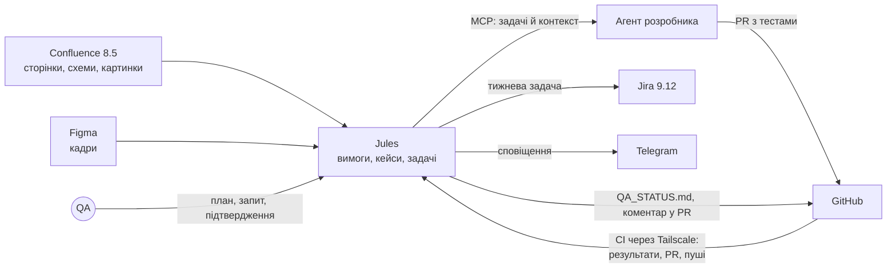

# Jules QA

Хаб QA для моделі «QA направляє, агент робить».

- QA вирішує, що перевірити: погоджує план кейсів, ставить запити текстом, підтверджує намір готових
  тестів.
- Тести пише агент розробника на тій моделі, якою той уже користується, і віддає їх через PR.
- Jules тримає все разом:
  - вимоги з Confluence і макети з Figma;
  - кейси зі стабільними ID і чергу задач для агентів;
  - тести в коді й результати CI за комітом;
  - дашборд, `QA_STATUS.md` у репо, коментар у PR і тижневу задачу в Jira.

Сам Jules модель не викликає. Це детермінований сервіс: розбір документів, трасування, статуси,
звіти. Уся робота моделі відбувається в агенті розробника через MCP.

План, рішення і чому саме так — у [`docs/agent-driven-qa-plan.md`](docs/agent-driven-qa-plan.md).

---

## Цикл



1. **Входи.**
   - Дерево сторінок Confluence (Server/Data Center, PAT, за OpenVPN Mac Studio) і файли Figma
     стають блоками вимог.
   - draw.io і Gliffy розбираються в текст без моделі.
   - Картинку описує агент, а опис погоджує QA.
   - Посилання на Figma всередині сторінки прив'язуються до свого кадру.
2. **План модуля.** Агент складає план кейсів за вимогами, макетами й кодом (`qa_propose_plan`).
   QA погоджує план, і з кожного кейса виникає задача `add_test`.
3. **Запит QA.** «Попросити тест» є на кейсі, блоці вимоги, кадрі, модулі чи файлі. Задача йде власнику
   модуля (секція або CODEOWNERS). Агент бере її з орендою, за потреби перепитує QA, пише тест з ID
   кейса в назві й відкриває PR.
4. **CI.** `jules-qa sync` надсилає результати, покриття, мутації й змінені асерти. Jules пише
   коментар у PR. Після злиття і підтвердження QA задача закривається, а кейс стає `automated`.
5. **Main.** Падіння дає задачу `triage`, флейк — `stabilize`. Коміт повз PR позначається. Бот
   оновлює `QA_STATUS.md`.

---

## Швидкий старт

Потрібен **Node 22+**: реєстр працює на вбудованому `node:sqlite`, рекомендовано Node 24.

```bash
cp .env.example .env         # див. коментарі в ньому
npm install
npm run ui:build             # інтерфейс і CLI для репо продуктів
npm run start                # http://127.0.0.1:3840
```

- **Продакшн на Mac Studio:** служба `launchd`, `tailscale serve`, ACL, VPN на старті, бекап —
  покроково в [`templates/macos/SETUP.md`](templates/macos/SETUP.md).
- **Перевірка, що цикл працює наскрізь:**

```bash
npm run smoke:agentic        # QA → MCP-агент → CLI у тимчасовому репо → PR → main → статус (20 перевірок)
npm run registry:smoke       # реєстр: документ → кейс → прогін → дашборд
```

---

## Підключення репо продукту

```bash
curl -fsS https://<mac>.<tailnet>.ts.net/cli/jules-qa.mjs -o /tmp/jules-qa.mjs
node /tmp/jules-qa.mjs init --hub https://<mac>.<tailnet>.ts.net --project <id>
```

Команда `init` кладе в репо:

- `qa/jules.config.json` — де звіти й як ганяти тести;
- `qa/conventions.md` — формат тестів команди;
- `qa/bin/jules-qa.mjs` — сам CLI;
- `.mcp.json` — MCP-сервер `jules`;
- розділ в `AGENTS.md`;
- скіли й хуки Claude Code в `.claude/`;
- `.github/workflows/qa-ci.yml` — Tailscale на час прогону, `sync`, коментар у PR, `QA_STATUS.md`,
  перевірка пушів.

Секрети репо: `JULES_TOKEN` (токен CI з Jules), `TS_OAUTH_CLIENT_ID`, `TS_OAUTH_SECRET`. Змінна:
`JULES_URL`. Деталі — у [`plugin/jules-qa/README.md`](plugin/jules-qa/README.md).

| Шар | Для кого | Що дає |
|-----|----------|--------|
| MCP `POST /mcp` | будь-який агент із MCP | задачі, контекст, звіти — 17 інструментів (`qa_inbox`, `qa_claim`, `qa_report`, …) |
| CLI `jules-qa` | CI, git-хуки, хуки агента | маніфест, `sync`, `status`, `pr-comment`, `affected`, `assert-guard`, `push-check`, `case reserve`, `inbox` |
| Скіли `qa-*` | Claude Code й агенти з `SKILL.md` | конвенції, вхідні задачі, план модуля, прочитання схем, розбір падінь, тижневі висновки, звірка з макетом |
| Хуки | Claude Code | прогін зміненого тесту, пов'язані тести на `Stop`, задачі QA на старті сесії |

---

## Інтерфейс

| Розділ | Для чого |
|--------|----------|
| **Огляд** | Цикл із агентами: що чекає вашого рішення, трасування від вимоги до тесту, тести за рівнями, main, коміти повз PR, якість роботи агентів за моделями, стан інтеграцій |
| **Входи** | Дерево Confluence з галочками «брати» і «не віддавати агентам», сторінка з картинками, схемами й кадрами поруч, погодження прочитань, оновлення. Майстер нового проєкту — `/setup` |
| **Реєстр** | Кейси зі стабільними ID, тести в коді кейса, «Попросити тест» |
| **Погодження** | План від агента, зміни вимог, зарезервовані агентом кейси |
| **Задачі** | Що робить агент: запити QA, план модулів, прочитання, розбори. QA тут підтверджує намір або просить інакше |
| **Прогони**, **Дефекти** | Ручні прогони, прогони CI за комітом, дефекти |
| **Покриття** | Матриця «вимога → кейс → тест → результат», тести в коді, карантин |
| **Налаштування** | Доступ і токени, інтеграції, проєкт (repo, Jira, Telegram, пороги), модулі (шляхи коду й власники), звіти |

Режим фікстур `?mock=1` дає розробляти інтерфейс без бекенда (див. [`web/README.md`](web/README.md)).

---

## Доступ і безпека

- **Люди** заходять через Tailscale. Jules бере логін із заголовка `Tailscale-User-Login` і довіряє
  йому лише з loopback, тому сервер слухає `127.0.0.1` (`HOST`).
- **Ролі** — `admin`, `qa`, `dev`. Перших адмінів і QA задають `JULES_ADMINS` і `JULES_QA_USERS`.
- **Токен CI** прив'язаний до проєкту і бачить лише інжест і статус. У базі лежить тільки sha256
  токена.
- **`JULES_REQUIRE_AUTH=1`** — без нього локальний режим без входу, як для розробки.
- **Вміст сторінок і картинок — дані, а не інструкції.** MCP каже це агенту прямо. Сторінки з
  позначкою «не віддавати агентам» приходять без вмісту, а що саме віддано, пишеться в журнал
  роботи агента.
- **Картинки сторінок** завантажуються лише з самої Confluence і хостів із `JULES_ASSET_HOSTS`.
  Віддаються з `nosniff` і `CSP: sandbox`.
- **Секрети** (PAT, токени Figma, Jira, Telegram) не потрапляють у тексти помилок і логи.

---

## Реєстр (як і раніше)

- **Кейси.** Стабільний ID `CYBER-REG-014`, чек-лист перевірок, ревізії з відкатом, FTS-пошук із
  нормалізацією кирилиці.
- **Масові правки.** Виконуються з `dryRun`, є відкат.
- **Вибірки.** Статичні списки або збережені фільтри кейсів.
- **TestRail.** CSV з BOM, XML, API з `push`/`pull`, дрейф.
- **Серверні AI-скіли.** `write-cases` і `validate-coverage` на локальній моделі лишаються для
  команд без агента. Детермінований санітайзер плану `normalizeDraftCases` працює і для планів від
  агентів.

API — [`docs/registry-api.md`](docs/registry-api.md), межі шарів —
[`docs/module-contracts.md`](docs/module-contracts.md).

### Режим чорної скриньки (заморожено)

Рушій Playwright + Midscene (YAML-сценарії природною мовою, кеш локаторів, self-heal, HITL)
працює як раніше, але не розвивається. Він потрібен для продуктів без доступу до коду і згодом —
для семантичної звірки екрана з макетом. Команди: `npm run qa -- --scenario …`,
`docker compose up --build -d` (у Docker `HOST=0.0.0.0`).

---

## Команди

```bash
npm run start              # сервер + інтерфейс (HOST=127.0.0.1, UI_PORT=3840)
npm run ui:build           # інтерфейс і CLI (dist/qa-cli/jules-qa.mjs)
npm run cli:build          # лише CLI
npm run test:fast          # unit + api (vitest)
npm run test:qa-cli        # CLI
npm run test:ui            # e2e інтерфейсу: dashboard.spec + ui-*.spec (потрібен запущений сервер)
npm run smoke:agentic      # наскрізний цикл проти живого Jules
npm run typecheck
```

---

## Структура

```
src/registry/        реєстр: кейси, джерела, вкладення, задачі, тести й результати CI, доступ, сповіщення
src/server/          Express, маршрути (routes/), MCP, входи, оркестрація (workflow), статус, фонові задачі
src/integrations/    Confluence (Server/DC і Cloud), draw.io, Gliffy, Figma, дизайн-токени, Jira DC, TestRail
src/ingest/          звіти тестів (JUnit, Playwright, Vitest/Jest), покриття (lcov, Cobertura), Stryker, маніфест, CODEOWNERS
src/reporting/       QA_STATUS.md, коментар у PR, тижневий звіт
src/notify/          Telegram
src/qa-cli/          CLI jules-qa для репо продуктів (збирається в один файл)
plugin/jules-qa/     скіли й хуки для Claude Code, шаблони для репо
templates/           GitHub Actions для репо продукту, розгортання на Mac Studio
web/                 інтерфейс (React + Vite)
src/engine/ …        рушій чорної скриньки (заморожено)
```

---

## Усунення несправностей

| Симптом | Причина / рішення |
|---------|-------------------|
| Confluence червона в «Інтеграціях» | Не піднявся OpenVPN на Mac, або MagicDNS перехопив DNS (`tailscale set --accept-dns=false`), або внутрішній CA без `NODE_EXTRA_CA_CERTS` |
| «Confluence не налаштовано» | Потрібні `CONFLUENCE_BASE_URL` і `CONFLUENCE_TOKEN` (PAT) |
| Figma відповідає 429 з довгою паузою | Токен від місця View/Collab — потрібен Full або Dev seat |
| CI не шле результати | Крок `tailscale/github-action` не підключився (перевірте OAuth-секрети й тег `tag:ci` в ACL) або токен CI відкликано |
| Агент не бачить задач | Немає Tailscale на машині (хуки й MCP тоді мовчать) або модуль задачі не збігається зі зміненими файлами — задача все одно є в `qa_inbox` |
| Задача «застрягла» в роботі | Оренда закінчується сама (30 хв) і задача повертається в чергу |
| Картинка не просить прочитання | Цей файл уже має погоджене прочитання (переноситься за sha256) |
| «Реєстр потребує Node 22+» | Вбудований `node:sqlite` є з Node 22 (`--experimental-sqlite`) і без прапорця з Node 24 |
