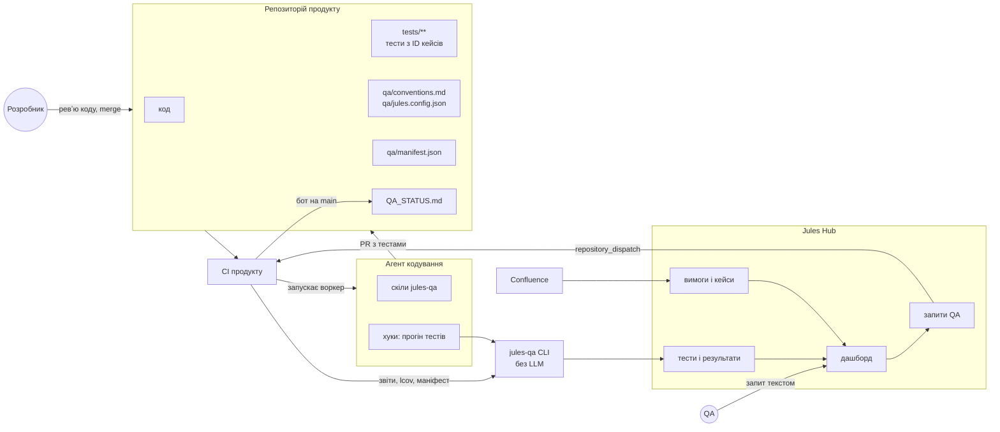
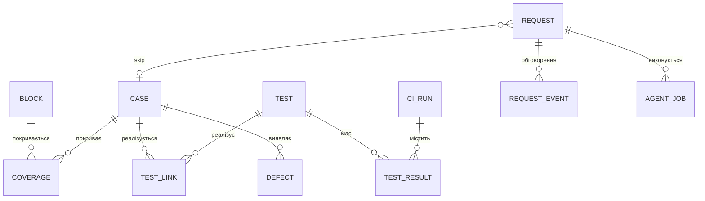
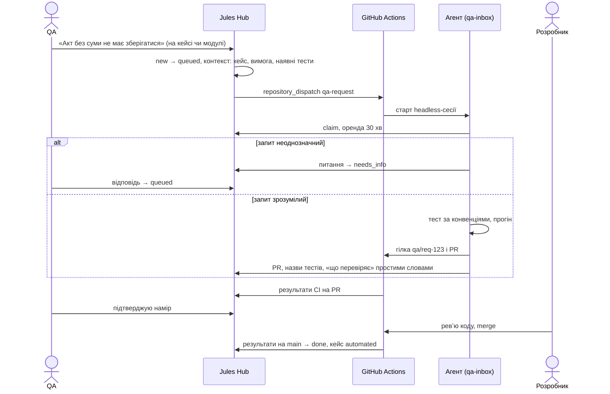
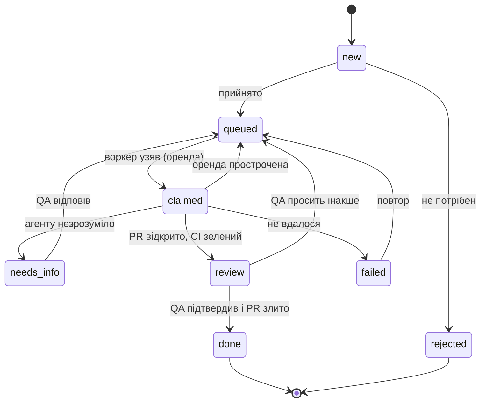

# Jules QA 2.0 — «QA направляє, агент робить»

План переробки Jules під флоу, де тести пише AI-агент у репозиторії продукту, а QA вирішує,
що саме треба перевірити. Документ складається з оцінки запропонованого флоу, доопрацювань,
цільової схеми роботи і дорожньої карти по фазах.

Статус: пропозиція на обговорення.

---

## 0. Коротко

**Вердикт.** Напрям правильний: QA відповідає за наміри, агент за виконання, а людина погоджує
результат. Близько половини потрібного в Jules уже є: реєстр кейсів зі стабільними ID, черга
погоджень, покриття вимог, прогони, дефекти й дашборд. **Новий «свій TestRail» будувати не треба,
треба навчити наявний реєстр бачити код.**

Але в поточному формулюванні флоу ламається в п'яти місцях:

| # | Проблема | Наслідок | Що змінюємо |
|---|----------|----------|-------------|
| 1 | Тести «з коду» перевіряють, що код **робить**, а не що він **мав би** робити | Баги закріплюються зеленими тестами, дашборд показує 90% покриття без жодної перевірки по суті | Еталон беремо з вимог і плану, погодженого QA. Розбіжність коду з вимогою оформлюємо як дефект і не підганяємо під неї тест |
| 2 | Скіл не вміє сам запускатися «раз на X хвилин» | Без процесу-виконавця пункт 4 не працює взагалі | Подія з дашборда запускає агента в CI, cron лишається як страховка |
| 3 | Агент дописує тести автоматично, без PR і без підтвердження | У репо потрапляють тести, яких ніхто не перевіряв, і зміни асертів під баг | Агент віддає результат лише через PR. Погоджень два: QA підтверджує намір, розробник перевіряє код |
| 4 | Результати пишуться в один файл, який оновлюється на кожен прогін | Конфлікти злиття, шум у git, нескінченний цикл «коміт → CI → коміт» | Ділимо на маніфест, що комітиться разом із тестами, і статус, який генерує бот лише на main |
| 5 | Немає зв'язку «вимога → кейс → тест у коді → результат» | Дашборд не може показати, що AI пропустила | Кожен тест у коді несе ID кейса, маніфест зв'язує їх, Jules будує матрицю |

**Головна зміна порядку.** Спершу замикаємо цикл «запит QA → PR з тестом → результат на дашборді»,
а первинне покриття будуємо поверх нього як пакет запитів, який згенерував агент і погодив QA.
Тоді bootstrap перестає бути окремим магічним кроком і стає тією самою перевіреною механікою,
тільки в масштабі.

---

## 1. Що є зараз і що змінюється

| Аспект | Зараз | Стане |
|--------|-------|-------|
| Звідки беруться тести | Confluence → чек-лист → YAML-сценарій для агента з комп'ютерним зором | Код продукту + вимоги → тести в репозиторії продукту (unit, integration, e2e) |
| Хто пише автотест | Рушій Midscene проходить кроки природною мовою | Агент кодування в репо продукту, за конвенціями команди |
| Де живуть тести | `scenarios/*.yaml` у Jules | `tests/**` у репо продукту, з ревʼю в PR |
| Хто виконує | Рушій Jules | CI продукту на звичних раннерах. Jules лише приймає результати |
| Роль QA | Верифікує кейси, проходить вручну | Формулює, що перевірити, погоджує план і наміри, код не пише |
| Роль Jules | Реєстр + рушій | Хаб: наміри (кейси), трасування, черга запитів QA, дашборд |

Що з наявного переходить у нову схему:

| Компонент Jules | Доля |
|-----------------|------|
| Реєстр: проєкти, секції, кейси зі стабільними ID, ревізії, пошук, масові операції | **Лишається як є.** Це ядро «свого TestRail» |
| Черга погоджень (`proposals`) | **Лишається.** Через неї йдуть план bootstrap і зміни кейсів |
| Джерела вимог, блоки, покриття (`sources`, `blocks`, `coverage`) | **Лишається.** Вимоги стають еталоном для тестів з коду |
| Прогони, елементи прогонів, дефекти, `flakeScore`, карантин | **Розширюється** результатами CI за SHA коміту |
| Правила авторингу (`src/registry/skills/prompts.ts`) і детермінований санітайзер | **Переїжджає** в конвенції тестів і в перевірку плану від агента |
| Серверні скіли `write-cases` / `validate-coverage` на локальній моделі | **Лишаються** для шляху «лише вимоги, без коду» і для генерації плану з вимог |
| Рушій Midscene, YAML-сценарії, кеш локаторів, self-heal, codegen | **Заморожується** як «режим чорної скриньки» (див. розділ 6) |
| Інтеграція TestRail | **Лишається** як експорт для команд, які з нього не йдуть |

---

## 2. Оцінка флоу по пунктах

### 2.1. «При створенні проєкту AI робить первинне покриття всієї логіки, формат задається скілами»

**Добре.** Швидкий старт. Формат через скіл обрано правильно: конвенції живуть у репо,
версіонуються й однакові для агента та людей.

**Що зламається.**

- **Еталон.** Тест, написаний за кодом, фіксує поточну поведінку разом із багами, тому зелений
  тест ще не означає правильну поведінку. Це головний ризик усього підходу.
- **Масштаб.** «Уся логіка» за раз означає сотні або тисячі тестів, які ніхто не прогляне.
  До цього додаються вартість і флейки.
- **Метрика.** Покриття рядків AI накручує легко: тест викликає функцію й нічого суттєвого
  не перевіряє.
- **Рівень.** «Уся логіка» на рівні unit дає крихкі тести на внутрішню реалізацію, які
  падають на кожному рефакторингу.

**Доопрацювання.**

1. Bootstrap складається з трьох кроків, після кожного є погодження:
   1. **Інвентар поведінки.** Агент складає карту модулів і точок входу: маршрути, API,
      сервіси, бізнес-правила.
   2. **План кейсів.** Агент відправляє в Jules пропозиції у форматі чек-листа: заголовок,
      рівень, пріоритет, `quote`/`derived`, посилання на код і на блок вимоги. QA погоджує
      план. Сто заголовків читаються за 15 хвилин, сто тестів так швидко не прочитати.
   3. **Код тестів.** Агент пише тести лише за погодженими кейсами, модуль за модулем,
      окремий PR на кожен модуль.
2. Модулі йдуть за ризиком: спершу P1 (гроші, доступи, основний потік). Кожен модуль має
   бюджет тестів і токенів.
3. Якщо код розходиться з вимогою, тест пишеться за вимогою й позначається як очікувано
   червоний (`test.fail()` / `xfail`), а в реєстрі з'являється дефект. Рішення приймає людина.
4. Силу тестів міряємо **мутаційним тестуванням** (Stryker для JS/TS, mutmut для Python,
   PIT для Java). Для P1-модулів це умова завершення. Додатково працює лінт тестів: тест без
   перевірок, тест лише зі snapshot і `expect(true)` заборонені.
5. Піраміда закріплюється в конвенціях. Бізнес-правила перевіряються unit-тестами, контракти
   API — integration-тестами, критичні потоки користувача — e2e (Playwright). Приватна
   реалізація не тестується.

### 2.2. «Другий скіл ганяє тести під час написання коду й пушить зміни в дашборд»

**Добре.** Агент швидко отримує зворотний зв'язок, дашборд актуальний.

**Що зламається.**

- Скіл — це інструкція, і модель може її не виконати. «Завжди запускати тести» має бути
  детермінованим кроком harness'у, а не проханням у промпті.
- Результати з ноутбука розробника на незакоміченому коді не описують стан продукту. Якщо
  вони потрапляють у той самий дашборд, QA бачить червоне чи зелене, якого немає в жодному
  коміті.
- Пуш на кожну зміну тесту дає шум і гонки між кількома сесіями.
- Агенту, якому треба «зробити зелено», найпростіше змінити очікуване значення в тесті.
  Так тести тихо знищуються.

**Доопрацювання.**

1. **Хуки Claude Code** замість прохання в скілі:
   - `PostToolUse` на редагування тест-файлу запускає цей файл;
   - `Stop` запускає тести, пов'язані зі зміненими файлами (`vitest related`,
     `jest --findRelatedTests`, `playwright test --only-changed`, `pytest --testmon`). Якщо
     тести червоні, хук повертає код 2, і агент не може завершити хід.
2. Синхронізацію робить **детермінований CLI** `jules-qa sync`, а не модель. Він розбирає
   JUnit/JSON-звіти раннерів, lcov і маніфест.
3. Результати бувають двох класів:
   - `local` прив'язаний до гілки й сесії, видно його як чернетку, на статус він не впливає;
   - `ci` прив'язаний до SHA коміту, і тільки він офіційний.

   За замовчуванням дашборд показує main, гілку чи PR можна вибрати.
4. **Охоронець асертів.** Якщо агент змінив наявні перевірки в тесті (рядки з `expect` чи
   `assert`) без запиту на зміну, PR отримує мітку `qa:assertion-change`, і потрібне
   погодження QA.
5. Без агента схема теж працює: те саме роблять pre-push-хук git і CI.

### 2.3. «QA бачить, що покрито й що AI пропустила, і текстом описує, що ще потрібно»

**Добре.** Це ядро моделі: QA працює на рівні намірів.

**Що зламається.**

- Без еталона не видно, що AI пропустила. Покриття рядків не відповідає на питання
  «чи перевірено, що акт без суми не зберігається».
- Вільний текст без прив'язки до чогось неоднозначний. Агент вгадує, і QA отримує не те,
  що просив.

**Доопрацювання.**

1. **Трасування в чотири шари:** блок вимоги → кейс (намір) → тест у коді → результат на коміті.
   Прогалини видно з п'яти боків:
   - вимога без кейсів;
   - кейс без тесту;
   - тест без кейса (агент перевірив те, чого ніхто не просив, і це теж сигнал);
   - код без покриття або з живими мутантами;
   - свіжі зміни коду без тестів.
2. Запит створюється з контексту: кнопка «Попросити тест» є на кейсі, прогалині, блоці
   вимоги, модулі й файлі. Так агент отримує якорі.
3. Агент має право перепитати. Запит переходить у стан `needs_info`, а QA бачить питання на
   дашборді. Одне питання дешевше за PR не про те.
4. До PR агент додає пояснення простими словами, що перевіряє тест, у форматі чек-листа.
   QA погоджує намір і не читає код.

### 2.4. «Скіл сам забирає запити з дашборда раз на X хвилин»

**Що зламається.**

- **Скіли самі за розкладом не запускаються.** Агента має запустити якийсь процес. Варіантів
  три: сесія Claude Code з `/loop` (живе, поки відкритий ноутбук), cron у CI або подія.
- Дві сесії можуть взяти один і той самий запит.
- Якщо результат іде в main або в поточну гілку розробника, з'являються конфлікти й код без ревʼю.
- Запит чекає до X хвилин, а порожні запуски коштують грошей.

**Доопрацювання.**

1. **Подієва модель.** Новий запит змушує Jules надіслати `repository_dispatch` у GitHub.
   Workflow запускає Claude Code у headless-режимі зі скілом `qa-inbox`. Cron раз на 30–60 хвилин
   працює як страховка, якщо подія загубилась. Локальний `/loop` лишається опцією для
   розробника, але не основним механізмом.
2. **Захоплення з орендою.** `claim` дає оренду на 30 хвилин із продовженням. Прострочена
   оренда повертає запит у чергу. Обробка ідемпотентна за ID запиту.
3. **Агент віддає результат лише через PR** з гілки `qa/req-<id>`, посилання повертається в
   запит. У main напряму агент не пише ніколи.
4. **Групування.** Запити по одному модулю в межах вікна йдуть одним PR.

### 2.5. «Результати пишуться в один файл у репо, розробник теж усе бачить»

**Що зламається.** Результат належить коміту, а не вмісту гілки. Якщо файл переписується
на кожен прогін, виникають конфлікти злиття між гілками й сотні комітів-шуму. З'являється цикл
«коміт результату → CI → новий результат → коміт». На фіча-гілці файл показує стан чужого коду.

**Доопрацювання: два файли, джерело даних одне.**

- `qa/manifest.json` — каталог «тест ↔ кейс ↔ рівень ↔ файл». Змінюється лише разом із тестами
  і генерується CLI, а pre-commit перевіряє, що він свіжий. Вміст детермінований і
  відсортований, тому диф у PR читається.
- `QA_STATUS.md` — статус для людей. Генерує його тільки CI на main (бот-коміт із `[skip ci]`).
  Вміст детермінований: час стоїть лише в заголовку. У `.gitattributes` файл позначено
  `linguist-generated`. На PR той самий звіт іде коментарем і в job summary.

### 2.6. Підсумкова оцінка

| Пункт флоу | Оцінка | Що робимо |
|------------|--------|-----------|
| Формат тестів через скіли | **Тримати** | Скіл `qa-conventions` + `qa/conventions.md` проєкту |
| Первинне покриття всієї логіки | **Змінити** | План від вимог і коду, погодження QA, модулі за ризиком, мутаційні ворота |
| Прогін тестів під час написання коду | **Доробити** | Хуки замість інструкції, результати `local` окремо від `ci`, охоронець асертів |
| Пуш у свій дашборд | **Тримати** | Детермінований CLI, джерело правди для статусу — CI за SHA |
| QA бачить прогалини й пише текстом | **Доробити** | Трасування в 4 шари, запити з якорями, право агента перепитати |
| Скіл опитує дашборд раз на X хвилин | **Змінити** | Подія + воркер у CI, оренда, вихід лише PR |
| Результати в один файл у репо | **Змінити** | Маніфест + статус від бота на main |
| Figma та візуальні перевірки | **Пізніше** | Фаза 6, три рівні від токенів до семантичного порівняння |

---

## 3. Цільова схема роботи

### 3.1. Компоненти



| Компонент | Що робить | Чого не робить |
|-----------|-----------|----------------|
| **Jules Hub** (цей репозиторій) | Зберігає наміри (кейси), трасування, запити QA, результати за комітами; показує дашборд; надсилає події | Не виконує тести й не редагує код продукту |
| **jules-qa CLI** | Будує маніфест, приймає звіти раннерів, визначає пов'язані тести, обслуговує хуки, отримує ID кейсів | Не викликає модель. Однаково поводиться в CI, локально й у хуках |
| **Плагін jules-qa** для Claude Code | Скіли й хуки, які встановлюються в репо продукту | Не зберігає стан, стан лежить у Jules і в git |
| **Воркер** | Claude Code у headless-режимі в GitHub Actions, обробляє запити QA | Не пише в main, не має продакшн-секретів |
| **CI продукту** | Запускає тести, покриття, вночі мутації, відправляє результати | — |

### 3.2. Трасування і модель даних



`BLOCK`, `CASE`, `COVERAGE` і `DEFECT` уже є. Решту додаємо:

| Сутність | Ключові поля | Навіщо |
|----------|--------------|--------|
| `repo` | `projectId`, провайдер, `owner/name`, гілка за замовчуванням, команди тестів | Зв'язок проєкту Jules з кодом |
| `test` | стабільний ключ (`repo + file + повна назва`), рівень (`unit` / `integration` / `e2e` / `visual`), фреймворк, автор (`agent` / `human`), стан (`active` / `skipped` / `quarantined` / `removed`), `firstSeenSha`, `lastSeenSha` | Тест у коді як окремий об'єкт |
| `test_link` | `testId`, `caseId` | Багато до багатьох: один кейс може мати тести на різних рівнях |
| `ci_run` | розширення `registry_runs`: `sha`, `branch`, `prNumber`, `source` (`ci` / `local` / `engine`) | Результат належить коміту |
| `test_result` | `testId`, `runId`, статус, тривалість, помилка, посилання на артефакти | Історія тесту, `flakeScore` з даних CI |
| `code_coverage` | `sha`, файл або модуль, рядки, гілки, mutation score | Сигнал «код без перевірок» |
| `request` | автор, текст, якір (кейс / блок / секція / файл / прогалина), вид (`add` / `change` / `remove` / `investigate`), стан, оренда, `prUrl` | Запит QA |
| `request_event` | автор (людина чи агент), текст, тип (`question` / `answer` / `interpretation` / `status`) | Діалог QA з агентом |
| `agent_job` | `requestIds[]`, воркер, гілка, PR, токени, вартість, результат | Облік і вартість, продовження `skill_runs` |

**Як тест знаходить кейс.** ID кейса стоїть у назві тесту. Це універсальний спосіб: назву видно
в будь-якому звіті раннера (JUnit XML, JSON), тому CLI не мусить розбирати код.

```ts
// Vitest / Jest
test('CYBER-ACT-014 акт без суми не зберігається', () => { /* … */ });

// Playwright: ID у назві, тег — опційно
test('CYBER-ACT-014 акт без суми не зберігається', { tag: '@P1' }, async ({ page }) => { /* … */ });
```

```python
def test_CYBER_ACT_014_act_without_amount_is_rejected(): ...
```

Якщо агент додає тест без запиту, він викликає `jules-qa case reserve --section ACT --title "…"`.
Jules створює чернетку кейса через чергу погоджень і повертає ID, тож ID є завжди. Якщо QA
відхиляє таку чернетку, автоматично створюється запит на видалення тесту.

**Хто чим володіє.** Кожен тип даних має одного власника, тому розсинхрону немає:

| Дані | Джерело правди | Інші бачать через |
|------|----------------|-------------------|
| Наміри (кейси, пріоритети, вимоги) | Jules | `jules-qa` CLI, скіли |
| Код тестів | Репо продукту | Маніфест → Jules |
| Зв'язок «тест ↔ кейс» | Назва тесту → маніфест | Jules (дрейф видно, як зараз для TestRail) |
| Результати | CI за SHA | Jules, `QA_STATUS.md`, PR-коментар |

### 3.3. Потоки

**A. Bootstrap (раз на проєкт, далі по модулях)**

1. `jules-qa init` пов'язує репо з проєктом Jules, пише `qa/jules.config.json`, ставить плагін,
   визначає стек (раннери, інструменти покриття).
2. `/qa-bootstrap <модуль>`: агент будує інвентар поведінки, підтягує з Jules блоки вимог і
   відправляє план кейсів у чергу погоджень.
3. QA погоджує, правит або відхиляє план на наявному екрані «Погодження».
4. Погоджені кейси стають пакетом запитів, далі їх обробляє потік D.
5. Модуль завершено, коли виконано три умови: усі P1-кейси мають тест, тести зелені або мають
   прив'язаний дефект, mutation score не нижчий за поріг.

**B. Внутрішній цикл розробника**

1. Скіл `qa-conventions` підвантажується, коли агент пише тести.
2. Хук `PostToolUse` проганяє змінений тест-файл. Хук `Stop` проганяє пов'язані тести і блокує
   завершення, якщо вони червоні.
3. Якщо з'явилася нова логіка без тестів (новий маршрут, функція чи гілка умови), хук
   `Stop` підказує, і агент дописує тести з резервуванням ID.
4. Хук `SessionStart` показує розробнику відкриті запити QA по модулях, які він зачіпає.
5. Локальні результати за налаштуванням ідуть у Jules як `local`.

**C. CI — єдине офіційне джерело статусу**

- **На PR:** тести (пов'язані або всі), покриття диффу, `jules-qa sync`. PR-коментар показує
  зачеплені кейси, нові тести, падіння і нову логіку без тестів.
- **На main:** повний прогін → Jules → `QA_STATUS.md` від бота.
- **Вночі:** мутаційне тестування P1-модулів (інкрементально), повний e2e, далі й візуальні
  перевірки.

**D. Запит QA (ядро моделі)**



**E. Змінилась вимога.** Механіка вже є: оновлення джерела з Confluence → змінені блоки →
пропозиції `case_update`. Нове тут одне: погоджена зміна кейса автоматично створює запит `change`
на пов'язані з ним тести.

**F. Тест упав на main.** Скіл `qa-triage` класифікує падіння:

| Клас | Що робимо |
|------|-----------|
| Баг продукту | Дефект із відтворенням, далі ним займається розробник |
| Баг тесту | Запит на зміну тесту через QA |
| Флейк | Карантин за `flakeScore` |
| Середовище | `blocked`, як зараз у рушії |

Асерти `qa-triage` не змінює ніколи.

### 3.4. Життєвий цикл запиту



---

## 4. Скіли й хуки (плагін `jules-qa`)

| Скіл або хук | Тип | Запуск | Що робить | Межі |
|--------------|-----|--------|-----------|------|
| `qa-conventions` | довідковий скіл | Автоматично, коли агент пише чи змінює тести | Формат тестів команди: піраміда, ID у назві, структура arrange–act–assert, фікстури, політика моків, заборонені патерни. Підтягує `qa/conventions.md` проєкту | Лише правила, нічого не запускає |
| `qa-bootstrap` | задача | Вручну, `/qa-bootstrap <модуль>` | Інвентар поведінки → план кейсів у Jules → після погодження пакет запитів | Без погодженого плану тестів не пише; бюджет на модуль |
| `qa-guard` | хуки + короткий скіл | `PostToolUse`, `Stop`, pre-push | Прогін пов'язаних тестів; блок завершення на червоному; підказка про логіку без тестів; мітка зміни асертів | Рішення ухвалює CLI, не модель |
| `qa-sync` | хук / крок CI | Після прогону | Маніфест, результати й покриття → Jules | Без LLM |
| `qa-inbox` | задача воркера | Подія з Jules, cron або `/loop` | Бере запит з орендою, уточнює або пише тест, відкриває PR, звітує в запит | Пише лише в `tests/**` і `qa/**`; без продакшн-секретів; результат — тільки PR |
| `qa-triage` | задача | Червоний тест на main | Класифікує падіння: дефект, запит на зміну тесту або карантин | Асерти не змінює |
| `qa-visual` | задача (фаза 6) | Запит з якорем на кадр Figma | Звіряє UI з макетом (розділ 11) | — |

Хуки плагіна:

```json
{
  "hooks": {
    "PostToolUse": [
      { "matcher": "Edit|Write|MultiEdit",
        "hooks": [{ "type": "command", "command": "npx jules-qa hook post-edit" }] }
    ],
    "Stop": [
      { "hooks": [{ "type": "command", "command": "npx jules-qa hook stop" }] }
    ],
    "SessionStart": [
      { "hooks": [{ "type": "command", "command": "npx jules-qa inbox --brief" }] }
    ]
  }
}
```

Конвенції за замовчуванням беремо з наявних правил авторингу (`src/registry/skills/prompts.ts`),
які вже погоджені з лідом QA, і перекладаємо їх із ручних кейсів на код:

- один тест перевіряє одну річ;
- назва в стилі чек-листа з ID кейса;
- до кожної вимоги дописуються негативні, межові й безпекові перевірки з позначкою `derived`;
- руйнівні дії заборонені;
- приватна реалізація не тестується;
- тест не може бути без перевірок, лише зі snapshot чи з `expect(true)`.

Проєкт перекриває будь-яке з правил у `qa/conventions.md`.

---

## 5. Файли в репозиторії продукту

```
qa/
  jules.config.json   # проєкт Jules, адреса хаба, команди тестів за рівнями, пороги
  conventions.md      # формат тестів команди (перекриває дефолти скіла)
  manifest.json       # генерується: тест ↔ кейс ↔ рівень ↔ файл
QA_STATUS.md          # генерується ботом лише на main
.claude/              # плагін jules-qa (скіли, хуки)
.github/workflows/
  qa-ci.yml           # тести → jules-qa sync → PR-коментар; на main — QA_STATUS.md
  qa-agent.yml        # воркер: repository_dispatch + cron
```

Приклад `QA_STATUS.md`:

```markdown
# Стан тестування · main @ 3f2a91c

| Модуль | Кейси | З тестами | Пройшли | Впали | Мутації | Запити QA |
|--------|------:|----------:|--------:|------:|--------:|----------:|
| Акти   |    42 |        38 |      37 |     1 |     71% |         2 |
| Оплати |    27 |        27 |      27 |     0 |     83% |         0 |

## Впали
- CYBER-ACT-021 Акт із датою в майбутньому відхиляється · tests/acts/date.test.ts · дефект CYBER-D-7

## P1 без тестів
- CYBER-ACT-030 Акт чужого контрагента недоступний за прямим URL
```

---

## 6. Зміни в Jules по модулях

**Лишається без змін**

- `src/registry/`: проєкти, секції, кейси, ревізії, ID, пошук, масові операції, погодження,
  дефекти, вибірки, джерела й покриття.
- `src/integrations/confluence.ts` (вимоги як еталон), `src/integrations/testrail-*` (експорт).
- `src/server/auth.ts`, SSE, оболонка `web/`, дизайн-токени, екрани «Реєстр» і «Погодження».

**Змінюється**

- `src/registry/types.ts`, `src/registry/migrations.ts`: нові сутності з розділу 3.2.
  `case.automation.scenarioPath` узагальнюється до списку тестів. Статус `automated`
  обчислюється з маніфесту на main, а не ставиться руками.
- `src/server/registry-routes.ts` (≈1900 рядків): до додавання нових маршрутів розрізати на
  роутери за доменами.
- `src/registry/dashboard.ts`: покриття в чотири шари, тести за рівнями, mutation score,
  час обробки запитів, вартість роботи агента.
- `src/server/auth.ts`: потрібні справжні користувачі й ролі (`qa`, `dev`, `agent`, `ci`).
  Зараз автор береться із заголовка `X-Jules-User`, тож назватися можна ким завгодно. Для CI
  і воркера потрібні машинні токени з обмеженням за проєктом і правами (`ingest`, `requests:claim`).
- `web/`:
  - «Покриття» стає матрицею «вимога → кейс → тест → результат» з вибором гілки;
  - новий екран «Запити» зі станами, обговоренням і посиланнями на PR;
  - у деталях кейса з'являються тести в коді з посиланнями на файл і рядок та результати за комітами;
  - нові віджети на дашборді.

**Нове**

- `src/ingest/`: парсери JUnit XML (універсальний), Playwright JSON, Vitest/Jest JSON, lcov,
  Cobertura, Stryker `mutation.json`. Маршрути
  `POST /api/registry/ingest/{manifest,results,coverage,mutation}`.
- `src/requests/`: сховище запитів, автомат станів, оренди, `repository_dispatch` у GitHub,
  вхідний вебхук про злитий чи закритий PR.
- `packages/jules-qa-cli/`: команди `init`, `manifest`, `sync`, `affected`, `hook`, `inbox`,
  `case reserve`, `status`.
- `plugin/jules-qa/`: плагін Claude Code зі скілами з розділу 4.
- `templates/github/`: `qa-ci.yml`, `qa-agent.yml` для репо продукту.

**Заморожується (режим чорної скриньки)**

- `src/engine/`, `src/planning/`, `src/codegen/`, `scenarios/`, `generated/`, Stagehand.
  Не видаляємо: це єдиний шлях для продуктів без доступу до коду, і в фазі 6 він знадобиться
  для семантичних візуальних перевірок. Нових вкладень не робимо, приклади переносимо в `examples/`.
- `.github/workflows/ai-qa.yml` запускається на Node 20, хоча `package.json` вимагає Node ≥22.
  Під час заморожування треба або виправити версію, або прибрати workflow.

---

## 7. Дорожня карта

Порядок фаз свідомий. Фаза 1 дає цінність навіть без агента, а bootstrap (фаза 4) стоїть після
циклу запитів (фаза 3), бо використовує саме його. Розмір фаз відносний: S — до тижня,
M — 1–2 тижні, L — понад 2 тижні.

| Фаза | Мета | Обсяг | Умова завершення | Розмір |
|------|------|-------|------------------|--------|
| **0. Рішення й підготовка** | Зняти невизначеності | Рішення з розділу 10; пілотне репо з живою командою; `qa/conventions.md` разом із лідом QA; розрізати `registry-routes.ts`; ролі й машинні токени | Є пілот, конвенції погоджено, токени CI й агента видано | S |
| **1. Трасування й інжест** | Дашборд бачить код | Конвенція ID; CLI `manifest` + `sync`; парсери; таблиці тестів і результатів; шаблон `qa-ci.yml`; матриця в 4 шари; `QA_STATUS.md`; PR-коментар | CI пілоту шле результати з кожного PR і з main; ≥90% тестів пілоту мають ID кейса, решта видно в списку «тести без кейса» | M |
| **2. Скіли в репо: конвенції й охоронець** | Агент не лишає червоне й пише в єдиному форматі | Плагін: `qa-conventions`, хуки, `affected`, охоронець асертів, `case reserve` | Сесії агента в пілоті не закінчуються на червоних тестах; нові тести мають ID; зміни асертів позначено | S–M |
| **3. Запити QA, замкнений цикл** | QA більше не пише тести руками | Запити, екран «Запити», автомат станів, оренда, dispatch, `qa-agent.yml`, `qa-inbox`, PR, підтвердження QA, вебхук про merge | ≥70% запитів QA погоджує з першої спроби; медіана «запит → PR» менше години; жодного пушу повз PR | M–L |
| **4. Первинне покриття** | Покрити наявний код без цементування багів | `qa-bootstrap`: інвентар → план → погодження → пакет запитів; мутаційні ворота для P1; бюджети | Усі P1-модулі пілоту мають погоджений план і тести; mutation score P1 не нижчий за поріг (поріг задаємо після заміру базової лінії) | M |
| **5. Розбір падінь і стабільність** | Червоне на main не висить і не замовчується | `qa-triage`; карантин за `flakeScore` з даних CI; дефекти з відтворенням; Jira через `externalKey` | Кожне падіння на main за добу отримує клас і власника | S–M |
| **6. Figma і візуальні перевірки** | QA просить «перевір екран за макетом» | Розділ 11 | Токени звіряються на кожному PR; ключові екрани мають візуальні перевірки | L |

---

## 8. Метрики успіху

| Метрика | Що показує | Звідки |
|---------|------------|--------|
| Частка погоджених кейсів із живим тестом на main | Реальне покриття намірів | маніфест + реєстр |
| Mutation score P1-модулів | Чи перевіряють тести щось по суті | Stryker / mutmut / PIT |
| Частка запитів, погоджених QA з першої спроби | Чи розуміє агент QA | `request` |
| Медіана «запит → PR» і «запит → merge» | Швидкість циклу | `request`, вебхуки |
| Тести без кейса / кейси без тесту | Здоров'я трасування | маніфест |
| Частка флейків і кейсів у карантині | Стабільність | `test_result`, `flakeScore` |
| Вартість на запит і на модуль bootstrap | Економіка | `agent_job` |
| Дефекти, що пройшли повз кейс, який уже мав тест | Кінцева якість | дефекти + трасування |
| Час QA, витрачений на написання тестів | Головна обіцянка моделі, має прямувати до нуля | опитування команди |

---

## 9. Ризики

| Ризик | Як проявиться | Що робимо |
|-------|---------------|-----------|
| Тести з коду закріплюють баги | Тести зелені, а баг є | План від вимог, погодження QA, очікувано червоні тести з дефектом |
| Агент підганяє тест під код | Асерти поступово слабшають | Охоронець асертів, мітка PR, погодження QA |
| Порожні тести, накручене покриття | Покриття росте, баги проходять | Мутаційне тестування, лінт тестів |
| Prompt injection: текст запиту, сторінки Confluence чи коментарі в коді керують агентом із правом запису | Агент робить не те, що просили | Запис лише в `tests/**` і `qa/**`; результат тільки через PR; жодних продакшн-секретів у воркера; справжня авторизація авторів запитів; вміст розглядається як дані, а не інструкції (правило вже є в README) |
| Флейкові e2e від AI | Червоне без причини | Перевага unit та integration; e2e лише для критичних потоків; карантин; повтор для підтвердження |
| Вартість | Рахунок за токени росте | Бюджети; подієвий запуск замість опитування; групування запитів; облік в `agent_job` |
| Забагато PR | Розробники перестають дивитись | Групування за модулем; PR зачіпає лише `tests/**`; автомерж після фази 3, якщо команда вирішить |
| Приватність коду | Код іде в хмарну модель | Рішення в розділі 10 |
| Розсинхрон Jules і репо | Кейс прибрано, а тест лишився | У кожного типу даних один власник (3.2); дрейф видно на дашборді |

---

## 10. Рішення, які треба ухвалити

| # | Питання | Варіанти | Рекомендація |
|---|---------|----------|--------------|
| 1 | Агент і модель для коду тестів | Claude Code (хмара) / локальна модель / гібрид | **Гібрид.** Claude Code пише код тестів, бо якість генерації коду тут критична. Локальна модель лишається для плану з вимог (`write-cases`), якщо вимоги не можна виносити назовні. Повністю локальний варіант можливий, але якість тестів буде помітно нижчою |
| 2 | Де працює воркер запитів | CI / машина розробника (`/loop`) / окремий сервер | **CI (GitHub Actions)**: подія + cron. `/loop` лишається опцією |
| 3 | Пілотний продукт і стек | — | Одне репо з живою командою. Стек визначає, які парсери й конвенції робимо першими |
| 4 | Хто погоджує | Лише QA / лише розробник / обидва | **Обидва:** QA погоджує намір у Jules, розробник — код у PR. До автомержу повертаємось після фази 3 |
| 5 | Файл у репо | `QA_STATUS.md` від бота на main / лише PR-коментар і дашборд | **`QA_STATUS.md` від бота + PR-коментар** |
| 6 | Чорна скринька (Midscene) | Заморозити / розвивати паралельно / видалити | **Заморозити**, а у фазі 6 використати для візуальних перевірок |

---

## 11. Розвиток: Figma і візуальні перевірки

Три рівні, від найдешевшого й найменш шумного:

1. **Токени.** Дешево й детерміновано. Кольори, типографіку, відступи й радіуси з Figma звіряємо
   з CSS-змінними чи темою в коді, тест падає, коли `--color-primary` розійшовся з макетом.
   Браузер не потрібен. Змінні можна брати через Figma MCP (`get_variable_defs`) або з експорту
   Tokens Studio. REST API змінних Figma доступний лише на тарифі Enterprise.
2. **Компоненти.** Знімки ізольованих компонентів за станами (default, hover, disabled, error)
   у Storybook і Playwright. Еталон — погоджений знімок застосунку. Figma служить довідкою на
   першому погодженні й під час ревʼю розбіжностей. Пряме піксельне порівняння з кадром Figma
   дає шум через шрифти, рендеринг і реальні дані, тому застосовуємо його лише з допуском і
   лише на ізольованих компонентах.
3. **Екрани.** Перевіряємо геометрію й обчислені стилі на заданих брейкпоінтах (відступи,
   вирівнювання, порядок блоків). Поверх цього модель із комп'ютерним зором робить семантичне
   порівняння «макет проти знімка»: «кнопка має бути primary», «під полем бракує підказки».
   Тут знадобиться наявний Midscene.

**Передумова — структурований дизайн-файл:** компоненти, змінні, кадри, названі за маршрутами
й станами. Без цього шум переважить користь. Запит QA «перевір екран X за макетом» іде тим самим
циклом запитів, якорем служить посилання на кадр Figma.

**Інші напрями розвитку**, які лягають на ту саму механіку запитів:

- **Аналіз впливу PR.** Агент на PR пише, що змінилось і які кейси це зачіпає, тож QA бачить
  ризик до merge.
- **«Баг → тест».** Кожен виправлений дефект автоматично отримує запит на регресійний тест.
- **Дослідницькі прогони.** Midscene проходить застосунок і пропонує кейси, яких немає в реєстрі.
- **Сигнали з продакшну.** Помилки з моніторингу стають запитами на тести.
