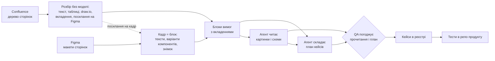
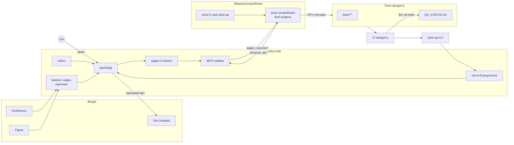
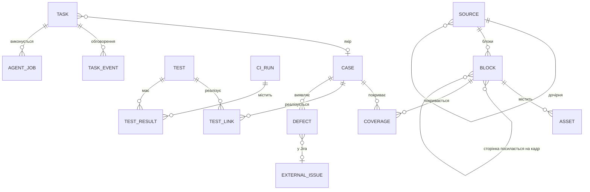
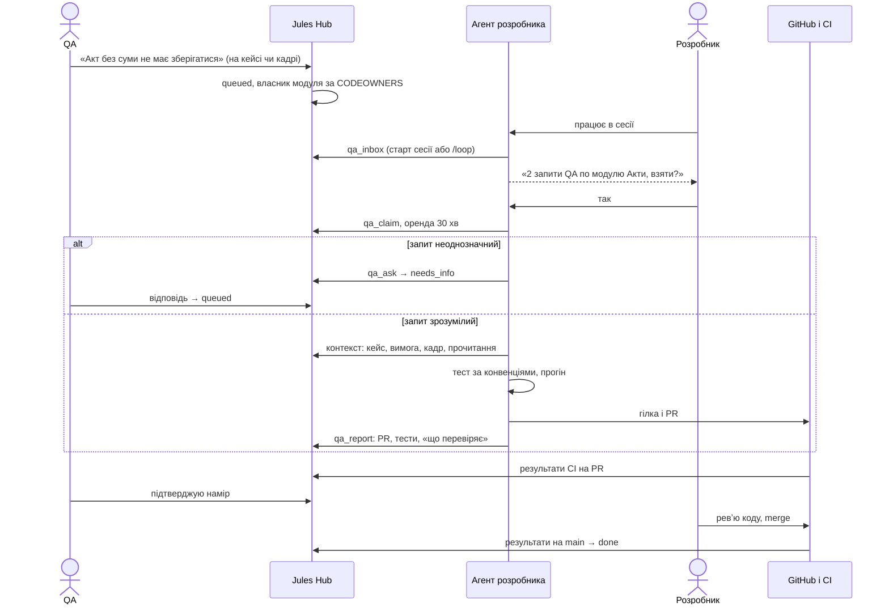
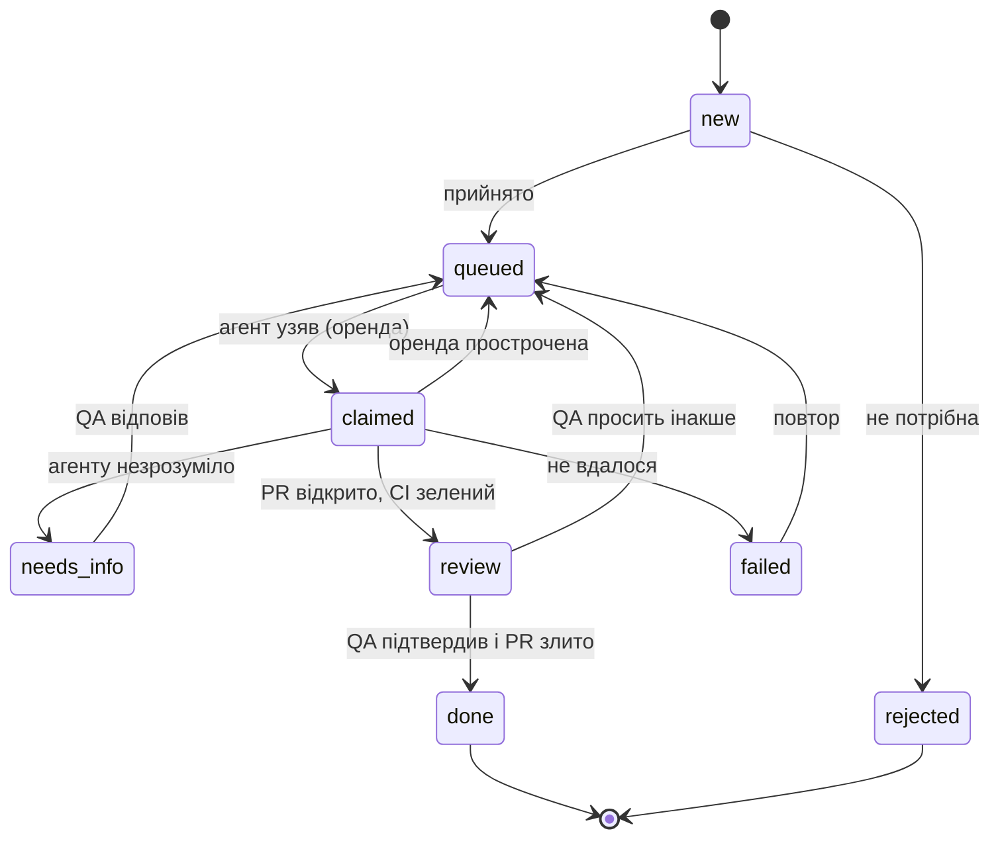

# Jules QA 2.0 — «QA направляє, агент робить»

План переробки Jules під флоу, де тести пише AI-агент у репозиторії продукту, а QA вирішує,
що саме треба перевірити. Документ складається з оцінки запропонованого флоу, вхідних даних
системи, цільової схеми роботи і дорожньої карти по фазах.

Статус: пропозиція на обговорення. Частину рішень ухвалено (розділ 11).

---

## 0. Коротко

**Вердикт.** Напрям правильний: QA відповідає за наміри, агент за виконання, а людина погоджує
результат. Близько половини потрібного в Jules уже є: реєстр кейсів зі стабільними ID, черга
погоджень, покриття вимог, прогони, дефекти й дашборд. **Новий «свій TestRail» будувати не треба,
треба навчити наявний реєстр бачити код, макети і схеми.**

**Ухвалені рішення**

1. **Модель — та, якою вже користується розробник.** Агент розробника сам забирає з Jules тести,
   задачі й запити QA і виконує їх. Звідси три наслідки:
   - Jules стає детермінованим хабом і власної моделі не потребує;
   - інтеграція не прив'язана до конкретного агента: MCP-сервер, CLI і скіли;
   - якість роботи різних моделей вирівнюють детерміновані ворота в CI, а не вибір моделі.
2. **Репозиторій продукту буде пізніше.** Фази підготовки і прийому вхідних даних стартують
   без нього, трасування чекає на репо.
3. **Статус у репо:** `QA_STATUS.md` від бота на main плюс коментар у PR.

**Що подається на вхід:**

- Confluence: проєкт або сторінка функціоналу з текстом, схемами, картинками й посиланнями на Figma;
- Figma: макети сторінок;
- Jira (згодом): щотижнева задача з результатами тестування.

Деталі — у розділі 2.

**Де флоу в початковому формулюванні ламається:**

| # | Проблема | Наслідок | Що змінюємо |
|---|----------|----------|-------------|
| 1 | Тести «з коду» перевіряють, що код **робить**, а не що він **мав би** робити | Баги закріплюються зеленими тестами | Еталон беремо з вимог і макетів через план, погоджений QA. Розбіжність оформлюємо як дефект і не підганяємо під неї тест |
| 2 | Агент розробника працює, лише коли працює розробник | Запити QA можуть днями лежати без руху | Маршрутизація до власника модуля, показ задач на старті сесії, опційний `/loop`, оренда, контроль віку запитів і ескалація |
| 3 | Агент дописує тести автоматично, без PR і без підтвердження | У репо потрапляють тести, яких ніхто не перевіряв, і асерти, підігнані під баг | Агент віддає результат лише через PR. Погоджень два: QA підтверджує намір, розробник перевіряє код |
| 4 | Результати пишуться в один файл, який оновлюється на кожен прогін | Конфлікти злиття, шум у git, нескінченний цикл «коміт → CI → коміт» | Маніфест комітиться разом із тестами, `QA_STATUS.md` генерує бот лише на main |
| 5 | Немає зв'язку «вимога/макет → кейс → тест у коді → результат» | Дашборд не може показати, що AI пропустила | Кожен тест у коді несе ID кейса, маніфест зв'язує їх, Jules будує матрицю |

**Головна зміна порядку.** Спершу треба замкнути цикл «запит → PR з тестом → результат на
дашборді». Первинне покриття стає великим пакетом таких запитів, які згенерував агент і погодив
QA. **Почати вже зараз, не чекаючи репо, можна з прийому вхідних даних:** дерево Confluence,
картинки, схеми, макети Figma.

---

## 1. Що є зараз і що змінюється

| Аспект | Зараз | Стане |
|--------|-------|-------|
| Вхідні дані | Одна сторінка Confluence. Картинки, draw.io-схеми та посилання на Figma відкидаються | Дерево сторінок Confluence з картинками й схемами, макети Figma, згодом Jira |
| Звідки беруться тести | Чек-лист → YAML-сценарій для агента з комп'ютерним зором | Вимоги, макети й код → тести в репо продукту (unit, integration, e2e) |
| Хто пише автотест | Рушій Midscene на моделі, налаштованій у Jules | Агент розробника на тій моделі, якою той користується |
| Де живуть тести | `scenarios/*.yaml` у Jules | `tests/**` у репо продукту, з ревʼю в PR |
| Хто виконує | Рушій Jules | CI продукту на звичних раннерах. Jules лише приймає результати |
| Роль QA | Верифікує кейси, проходить вручну | Формулює, що перевірити, погоджує план і наміри, код не пише |
| Роль Jules | Реєстр, рушій, серверні AI-скіли | Детермінований хаб: входи, наміри, трасування, черга задач для агентів, дашборд, звіти |

Що з наявного переходить у нову схему:

| Компонент Jules | Доля |
|-----------------|------|
| Реєстр: проєкти, секції, кейси зі стабільними ID, ревізії, пошук, масові операції | **Лишається як є.** Це ядро «свого TestRail» |
| Черга погоджень (`proposals`) | **Лишається.** Через неї йдуть план кейсів, прочитання схем і зміни кейсів |
| Джерела вимог, блоки, хеші, покриття | **Розширюється** на дерево сторінок, вкладення і кадри Figma |
| Імпорт Confluence (`src/integrations/confluence.ts`) | **Розширюється:** дерево, вкладення, draw.io, посилання на Figma, Server/Data Center |
| Прогони, елементи прогонів, дефекти, `flakeScore`, карантин | **Розширюється** результатами CI за SHA коміту |
| Правила авторингу (`src/registry/skills/prompts.ts`) і детермінований санітайзер | **Переїжджає** в конвенції тестів і в перевірку плану від агента |
| Серверні скіли `write-cases` / `validate-coverage` | **Стають опційними.** План складає агент розробника, а серверні скіли лишаються для команд без агента |
| Рушій Midscene, YAML-сценарії, кеш локаторів, self-heal, codegen | **Заморожується** як «режим чорної скриньки» (розділ 7) |
| Інтеграція TestRail | **Лишається** як експорт для команд, які з нього не йдуть |

---

## 2. Вхідні дані

### 2.1. Проєкт у Jules — це набір посилань

Під час створення проєкту QA вставляє посилання, а Jules підтягує дані без участі моделі:

| Вхід | Що вставляє QA | Що робить Jules |
|------|----------------|-----------------|
| Confluence | Посилання на простір, кореневу сторінку проєкту або сторінку окремого функціоналу | Тягне сторінку з дочірніми, показує дерево з галочками «брати / не брати» і пропонує з нього дерево модулів |
| Figma | Посилання на файл, сторінку або кадр | Тягне кадри сторінок як блоки вимог: тексти, варіанти компонентів, знімок |
| Репозиторій | URL репо (надасте пізніше) | Зв'язує проєкт з кодом, видає токен для CI |
| Jira (згодом) | Ключ проєкту | Щотижнева задача зі звітом, дефекти після підтвердження QA |

Посилання на Figma, знайдені всередині сторінок Confluence, Jules підхоплює сам і зв'язує з
блоком вимоги, де вони стоять. Так агент отримує текст вимоги і макет того самого функціоналу разом.

Коли входи прийнято, Jules створює для кожного модуля системну задачу `plan_module`, і агенти
розробників починають первинне покриття (потік B у розділі 4.3).

### 2.2. Confluence

| Елемент сторінки | Зараз | Стане |
|------------------|-------|-------|
| Сторінка | Одна, за посиланням | Сторінка з дочірніми або весь простір. Дерево сторінок пропонує дерево модулів |
| Текст, заголовки, списки, таблиці | Є | Без змін |
| Макроси info / note / panel / expand | Розгортаються, текст лишається | Без змін |
| Картинки (`ac:image`, вкладення й зовнішні URL) | Відкидаються | Завантажуються, зберігаються за хешем і прив'язуються до блоку, де стоять |
| draw.io | Відкидається | XML схеми розбирається без моделі: вузли, зв'язки, підписи стають текстом «A → B (умова)». PNG-превʼю зберігається поруч |
| Gliffy | Відкидається | Розбираємо JSON-вкладення так само, як draw.io |
| PlantUML / Mermaid (макроси застосунків) | Відкидаються | Текст діаграми зберігається як є |
| Lucidchart та інші вбудовані схеми без даних | Відкидаються | Лише знімок, далі його читає агент |
| Посилання й вбудовування Figma | Відкидаються | Ключ файлу та ID кадру зв'язують блок із кадром Figma |
| Макроси Jira (ключі задач) | Відкидаються | Зберігаються як посилання, знадобляться у фазі Jira |
| Версія сторінки | Є, хеші блоків | Плюс нові й видалені сторінки дерева |

**Картинки й схеми, з яких текст без моделі не дістати** (скріни, фото дошки, Lucidchart),
читає агент розробника. Схема така:

1. Jules позначає блок як такий, що потребує прочитання, і створює задачу `read_asset`.
2. Агент описує, що бачить на картинці: кроки флоу, поля, умови, стани.
3. Опис іде на погодження QA разом із планом кейсів. Помилково прочитана схема дає хибні тести,
   тому без людини тут не можна.
4. Погоджене прочитання зберігається за хешем картинки. Поки картинка не змінилась, її не
   перечитують.

**Що врахувати:**

- Зараз код підтримує лише Confluence Cloud. Server/Data Center має інші адреси API і
  персональні токени, це треба знати до старту (розділ 11).
- Для дерева універсальний шлях — CQL `ancestor = <id>`, він працює і в Cloud, і в Data Center.
- Вкладення завантажуються з тією самою автентифікацією, що й сторінки.

### 2.3. Figma

| Що беремо | Як | Навіщо |
|-----------|----|--------|
| Кадри сторінок і станів | Дерево файлу через REST API. Кадр верхнього рівня стає блоком вимоги, тобто Figma — ще один вид джерела поряд із Confluence | Кадр без кейсів видно як прогалину, так само як блок вимоги |
| Усі тексти кадру | Вузли `TEXT` у порядку читання | Точні тексти кнопок, підписів, помилок і порожніх станів стають перевірками в тестах |
| Варіанти компонентів | Назви інстансів і їхні властивості (`Button / Primary / Disabled`) | Стани, які треба перевірити: вимкнено, помилка, завантаження |
| Знімок кадру | Експорт PNG, кеш за версією файлу | Контекст для агента, згодом еталон для візуальних перевірок |
| Версія файлу | Легкий запит метаданих | Змінився макет → змінився хеш кадру → пропозиції оновити кейси й задачі `change_test`, так само як для Confluence |
| Коментарі дизайнерів (опційно) | API коментарів | Уточнення, яких немає в макеті |

**Суперечності між вимогою, макетом і кодом** — один із найцінніших результатів системи.
Наприклад, у Confluence написано «сума обов'язкова», а на макеті поле без зірочки, або текст
помилки в макеті й у коді різний. Агент не обирає, хто правий: він відкриває питання для QA,
а той вирішує разом з аналітиком чи дизайнером.

**Що врахувати:**

- Ліміти REST API Figma залежать від тарифу й типу місця власника токена. Для місць View чи
  Collab вони дуже низькі, тому токен потрібен від користувача з Full або Dev seat. Jules кешує
  все за версією файлу, щоб кожному розробнику не потрібен був власний доступ до Figma.
- Jules — єдиний шлюз до Figma для агентів. Якщо в розробника є власний Figma MCP, агент може
  брати з нього більше деталей, але базовий контекст однаковий для всіх.
- Кадри треба зіставити з маршрутами застосунку (кадр → URL і стан). Для генерації кейсів
  це не обов'язково, для візуальних перевірок — обов'язково.

### 2.4. Jira (на майбутнє)

**Щотижнева задача з результатами тестування:**

- Збір цифр робить Jules детерміновано, щоб модель не вигадувала числа. До звіту входять:
  прогони на main, успішність і її динаміка, нові та закриті дефекти, приріст кейсів із тестами,
  P1 без тестів, запити QA (створені, закриті, найстаріші), флейки й карантин, зміни у вимогах
  і макетах за тиждень.
- Висновки «на що звернути увагу» пише агент через скіл `qa-weekly`. Запускає його QA-лід або
  розклад у його сесії. На старті звіт можна вести і без висновків.
- На тиждень створюється одна задача з міткою `jules-weekly-<рік>-W<тиждень>`. Повторний запуск
  оновлює її, а не створює дубль.
- Згодом можна заводити баги в Jira з дефектів реєстру, але лише після підтвердження QA. Поля
  `externalKey` і `externalUrl` у дефектах уже є.

**Згодом Jira може стати й входом:**

- історії з критеріями приймання — ще одне джерело вимог;
- ключ задачі в коміті чи PR — аналіз впливу: «задача PROJ-123 зачепила ці модулі, перевірте ці кейси».

Для Jira Cloud і Confluence Cloud одного сайту підходить той самий API-токен Atlassian.

### 2.5. Як входи стають тестами



---

## 3. Оцінка флоу по пунктах

### 3.1. «При створенні проєкту AI робить первинне покриття всієї логіки, формат задається скілами»

**Добре.** Швидкий старт. Формат через скіл обрано правильно: конвенції живуть у репо,
версіонуються й однакові для агента та людей.

**Що зламається.**

- **Еталон.** Тест, написаний за кодом, фіксує поточну поведінку разом із багами, тому зелений
  тест ще не означає правильну поведінку.
- **Масштаб.** «Уся логіка» за раз означає сотні або тисячі тестів, які ніхто не прогляне.
- **Метрика.** Покриття рядків AI накручує легко: тест викликає функцію й нічого суттєвого
  не перевіряє.
- **Рівень.** «Уся логіка» на рівні unit дає крихкі тести на внутрішню реалізацію.

**Доопрацювання.**

1. Bootstrap складається з трьох кроків, після кожного є погодження:
   1. **Інвентар поведінки.** Агент складає карту модулів і точок входу: маршрути, API, сервіси,
      бізнес-правила.
   2. **План кейсів.** Агент складає план за вимогами, макетами і кодом і відправляє в Jules
      пропозиції у форматі чек-листа: заголовок, рівень, пріоритет, `quote`/`derived`, посилання
      на код, блок вимоги й кадр Figma. QA погоджує план. Сто заголовків читаються за 15 хвилин,
      сто тестів так швидко не прочитати.
   3. **Код тестів.** Агент пише тести лише за погодженими кейсами, модуль за модулем,
      окремий PR на кожен модуль.
2. Модулі йдуть за ризиком: спершу P1 (гроші, доступи, основний потік). Кожен модуль має бюджет.
3. Якщо код розходиться з вимогою або макетом, тест пишеться за вимогою й позначається як
   очікувано червоний (`test.fail()` / `xfail`), а в реєстрі з'являється дефект або питання.
   Рішення приймає людина.
4. Силу тестів міряємо **мутаційним тестуванням** (Stryker для JS/TS, mutmut для Python,
   PIT для Java). Для P1-модулів це умова завершення. Додатково працює лінт тестів: тест без
   перевірок, тест лише зі snapshot і `expect(true)` заборонені.
5. Піраміда закріплюється в конвенціях. Бізнес-правила перевіряються unit-тестами, контракти
   API — integration-тестами, критичні потоки користувача — e2e (Playwright). Приватна
   реалізація не тестується.

### 3.2. «Другий скіл ганяє тести під час написання коду й пушить зміни в дашборд»

**Добре.** Агент швидко отримує зворотний зв'язок, дашборд актуальний.

**Що зламається.**

- Скіл — це інструкція, і модель може її не виконати. Моделі в розробників різні, тож
  поведінка теж буде різною.
- Результати з ноутбука розробника на незакоміченому коді не описують стан продукту.
- Пуш на кожну зміну тесту дає шум і гонки між сесіями.
- Агенту, якому треба «зробити зелено», найпростіше змінити очікуване значення в тесті.

**Доопрацювання.**

1. **Хуки замість прохання в скілі.** У Claude Code це `PostToolUse` (прогін зміненого
   тест-файлу) і `Stop` (прогін пов'язаних тестів, червоне не дає завершити хід). Для агентів
   без хуків той самий захист дають git-хук pre-push і CI.
2. Синхронізацію робить **детермінований CLI** `jules-qa sync`, а не модель.
3. Результати бувають двох класів:
   - `local` прив'язаний до гілки й сесії, на статус він не впливає;
   - `ci` прив'язаний до SHA коміту, і тільки він офіційний.
4. **Охоронець асертів.** Якщо агент змінив наявні перевірки в тесті без задачі `change_test`,
   PR отримує мітку `qa:assertion-change`, і потрібне погодження QA.

### 3.3. «QA бачить, що покрито й що AI пропустила, і текстом описує, що ще потрібно»

**Добре.** Це ядро моделі: QA працює на рівні намірів.

**Що зламається.**

- Без еталона не видно, що AI пропустила.
- Вільний текст без прив'язки до чогось неоднозначний.

**Доопрацювання.**

1. **Трасування:** блок вимоги або кадр Figma → кейс → тест у коді → результат на коміті.
   Прогалини видно з кількох боків:
   - вимога чи кадр без кейсів;
   - кейс без тесту;
   - тест без кейса;
   - код без покриття або з живими мутантами;
   - свіжі зміни коду без тестів;
   - суперечність між вимогою, макетом і кодом.
2. Запит створюється з контексту: кнопка «Попросити тест» є на кейсі, прогалині, блоці вимоги,
   кадрі макета, модулі й файлі.
3. Агент має право перепитати, і запит переходить у стан `needs_info`.
4. До PR агент додає пояснення простими словами, що перевіряє тест. QA погоджує намір і не
   читає код.

### 3.4. «Агент сам забирає запити з дашборда раз на X хвилин»

З ухваленим рішенням про модель цей пункт стає реалістичним. Забирає задачі агент розробника
в його сесії, а не окремий воркер.

**Що зламається.**

- Сесія агента є, лише поки працює розробник. Вночі, у вихідні й коли модулем ніхто не
  займається, запити лежать.
- Кілька розробників можуть узяти один запит.
- Агент, який раптом перемкнувся на запит QA, зриває розробнику поточну задачу.

**Доопрацювання.**

1. **Маршрутизація.** Запит іде власнику модуля (за `CODEOWNERS` або налаштуванням у Jules),
   але взяти його може будь-хто.
2. **Три способи підхопити задачу:**
   - хук `SessionStart` показує «2 запити QA по модулю Акти»;
   - агент сам пропонує запити по модулю, з яким розробник зараз працює;
   - розробник явно запускає `/qa-inbox` або `/loop 15m /qa-inbox` у виділений час.

   Агент пропонує задачу, а рішення взяти її ухвалює розробник.
3. **Оренда.** `claim` дає оренду на 30 хвилин із продовженням. Прострочена оренда повертає
   запит у чергу.
4. **Вік запитів.** Дашборд показує, скільки запит чекає. Після порогу Jules сповіщає QA-ліда,
   а найстаріші запити потрапляють у тижневий звіт.
5. **Агент віддає результат лише через PR.** Запит, що стосується фічі, над якою розробник
   працює, може піти в його PR. Інші запити йдуть окремою гілкою `qa/req-<id>`.

### 3.5. «Результати пишуться в один файл у репо»

Ухвалено: **`QA_STATUS.md` генерує бот лише на main, на PR той самий звіт іде коментарем.**

- `qa/manifest.json` — каталог «тест ↔ кейс ↔ рівень ↔ файл». Змінюється лише разом із тестами,
  а pre-commit перевіряє, що він свіжий.
- `QA_STATUS.md` оновлюється бот-комітом із `[skip ci]`. Вміст детермінований, тому диф
  читається. У `.gitattributes` файл позначено `linguist-generated`.

### 3.6. Підсумкова оцінка

| Пункт флоу | Оцінка | Що робимо |
|------------|--------|-----------|
| Формат тестів через скіли | **Тримати** | Скіл `qa-conventions` + `qa/conventions.md` проєкту |
| Первинне покриття всієї логіки | **Змінити** | План від вимог, макетів і коду, погодження QA, модулі за ризиком, мутаційні ворота |
| Прогін тестів під час написання коду | **Доробити** | Хуки й CI замість інструкції, `local` окремо від `ci`, охоронець асертів |
| Пуш у свій дашборд | **Тримати** | Детермінований CLI, статус — з CI за SHA |
| QA бачить прогалини й пише текстом | **Доробити** | Трасування з вимогами й макетами, запити з якорями, право агента перепитати |
| Агент забирає запити | **Тримати з доробками** | Агент розробника через MCP, маршрутизація, оренда, контроль віку, вихід лише PR |
| Результати в один файл | **Ухвалено** | Маніфест + `QA_STATUS.md` від бота + PR-коментар |
| Figma | **Розділити** | Як вхід для кейсів — рано (фаза 1), візуальні перевірки — пізно (фаза 7) |
| Jira | **Пізніше** | Тижнева задача з цифр Jules, висновки від агента, одна задача на тиждень |

---

## 4. Цільова схема роботи

### 4.1. Компоненти



| Компонент | Що робить | Чого не робить |
|-----------|-----------|----------------|
| **Jules Hub** (цей репозиторій) | Приймає входи, зберігає наміри й трасування, роздає задачі агентам, приймає результати, показує дашборд, формує звіти | Не викликає модель, не виконує тести, не редагує код продукту |
| **MCP-сервер Jules** | Через нього будь-який агент із підтримкою MCP отримує задачі й контекст і звітує | Не ухвалює рішень за людей |
| **jules-qa CLI** | Маніфест, прийом звітів раннерів, визначення пов'язаних тестів, хуки, резервування ID | Не викликає модель. Однаково поводиться в CI, локально й у хуках |
| **Скіли й хуки jules-qa** | Конвенції і порядок роботи для агента, ставляться в репо продукту | Не зберігають стан, стан лежить у Jules і в git |
| **Агент розробника** | Будь-який агент на моделі розробника: план, тести, прочитання схем, розбір падінь | Не пише в main, асерти змінює лише за задачею |
| **CI продукту** | Тести, покриття, вночі мутації, відправка результатів, `QA_STATUS.md` | — |

### 4.2. Трасування і модель даних



`SOURCE`, `BLOCK`, `CASE`, `COVERAGE` і `DEFECT` уже є. Решту додаємо або розширюємо:

| Сутність | Ключові поля | Навіщо |
|----------|--------------|--------|
| `source` (розширення) | вид (`confluence` / `figma` / `file` / `paste`, згодом `jira`), `parentId`, «брати / не брати» | Дерево сторінок, Figma як джерело |
| `block` (розширення) | для кадру Figma: ID вузла, маршрут застосунку | Кадр як вимога |
| `asset` | блок, вид (`image` / `diagram` / `frame`), хеш, файл, текст, витягнутий без моделі, прочитання агентом, хто погодив | Картинки, схеми, знімки кадрів |
| `block_link` | блок сторінки ↔ блок кадру | Текст вимоги і макет одного функціоналу поруч |
| `repo` | `projectId`, `owner/name`, гілка за замовчуванням, команди тестів | Зв'язок із кодом |
| `test` | стабільний ключ (`repo + file + повна назва`), рівень, фреймворк, автор (`agent` / `human`), стан | Тест у коді як об'єкт |
| `test_link` | `testId`, `caseId` | Один кейс може мати тести на різних рівнях |
| `ci_run` | розширення `registry_runs`: `sha`, `branch`, `prNumber`, `source` (`ci` / `local` / `engine`) | Результат належить коміту |
| `test_result` | `testId`, `runId`, статус, тривалість, помилка, артефакти | Історія тесту, `flakeScore` з CI |
| `code_coverage` | `sha`, файл або модуль, рядки, гілки, mutation score | Сигнал «код без перевірок» |
| `task` | вид (таблиця нижче), автор (QA чи система), текст, якір, власник, стан, оренда, `prUrl`, вік | Черга задач для агентів |
| `task_event` | автор (людина чи агент), текст, тип (`question` / `answer` / `interpretation` / `status`) | Діалог QA з агентом |
| `agent_job` | задачі, агент і модель (з його слів), гілка, PR, результат | Облік і частка прийнятих QA результатів |
| `external_issue` | ключ Jira, вид (`weekly_report` / `defect`), тиждень, URL | Зв'язок із Jira без дублів |

**Задачі для агентів.** Агент розробника підхоплює з Jules не лише запити QA на тести, а й
решту керування тестами:

| Вид задачі | Хто створює | Що робить агент |
|------------|-------------|-----------------|
| `add_test` | QA | Пише тест |
| `change_test` | QA або система (змінилась вимога чи макет) | Змінює тест. Змінювати асерти дозволено саме тут |
| `remove_test` | QA або система (кейс відхилено чи застарів) | Прибирає тест |
| `plan_module` | Система (новий проєкт чи модуль) | Інвентар і план кейсів на погодження |
| `read_asset` | Система (блок, зміст якого лише в картинці чи схемі) | Описує картинку, опис іде на погодження |
| `triage` | Система (червоне на main) | Класифікує падіння |
| `stabilize` | Система (`flakeScore` вище порогу) | Лікує флейк, не послаблюючи перевірок |

Суперечності між вимогою, макетом і кодом агент не розв'язує сам. Він створює питання для людей.

**Як тест знаходить кейс.** ID кейса стоїть у назві тесту. Назву видно в будь-якому звіті
раннера, тому CLI не мусить розбирати код.

```ts
// Vitest / Jest
test('CYBER-ACT-014 акт без суми не зберігається', () => { /* … */ });

// Playwright
test('CYBER-ACT-014 акт без суми не зберігається', { tag: '@P1' }, async ({ page }) => { /* … */ });
```

```python
def test_CYBER_ACT_014_act_without_amount_is_rejected(): ...
```

Якщо агент додає тест без задачі, він резервує ID: `jules-qa case reserve --section ACT --title "…"`.
Jules створює чернетку кейса через чергу погоджень. Якщо QA відхиляє чернетку, з'являється задача
`remove_test`.

**Хто чим володіє:**

| Дані | Джерело правди | Інші бачать через |
|------|----------------|-------------------|
| Вимоги, схеми | Confluence | Jules (кеш за хешами) |
| Макети | Figma | Jules (кеш за версією файлу) |
| Наміри (кейси, пріоритети), прочитання схем | Jules | MCP, CLI, скіли |
| Код тестів | Репо продукту | Маніфест → Jules |
| Зв'язок «тест ↔ кейс» | Назва тесту → маніфест | Jules (дрейф видно, як зараз для TestRail) |
| Результати | CI за SHA | Jules, `QA_STATUS.md`, PR-коментар, тижнева задача в Jira |

### 4.3. Потоки

**A. Створення проєкту і прийом входів.** Це робить Jules, модель не потрібна.

1. QA вставляє посилання на Confluence і Figma.
2. Jules тягне дерево сторінок, вкладення й кадри, розбирає draw.io, зв'язує сторінки з кадрами.
3. QA ставить галочки на потрібних сторінках і підтверджує запропоноване дерево модулів.
4. На кожен модуль створюється `plan_module`, на кожну картинку без тексту — `read_asset`.

**B. Первинне покриття.** Його робить агент розробника по модулях.

1. Агент бере `plan_module`. Через MCP він отримує вимоги, кадри й прочитання, а з репо — код.
2. План кейсів і прочитання картинок ідуть на погодження в чергу «Погодження».
3. Погоджені кейси стають задачами `add_test`, далі працює потік E.
4. Модуль завершено, коли виконано три умови: усі P1-кейси мають тест, тести зелені або мають
   прив'язаний дефект, mutation score не нижчий за поріг.

**C. Внутрішній цикл розробника**

1. Скіл `qa-conventions` підвантажується, коли агент пише тести.
2. Хуки або pre-push проганяють пов'язані тести, червоне не дає завершити хід чи запушити.
3. Нова логіка без тестів → підказка, агент дописує тести з резервуванням ID.
4. На старті сесії агент показує задачі по модулях, які розробник зачіпає.

**D. CI — єдине офіційне джерело статусу**

- **На PR:** тести, покриття диффу, `jules-qa sync`, PR-коментар (зачеплені кейси, нові тести,
  падіння, нова логіка без тестів).
- **На main:** повний прогін → Jules → `QA_STATUS.md` від бота.
- **Вночі:** мутаційне тестування P1-модулів (інкрементально), повний e2e, згодом візуальні перевірки.

**E. Запит QA (ядро моделі)**



**F. Змінилась вимога або макет**

1. Повторний імпорт Confluence чи нова версія файлу Figma.
2. Змінені блоки або кадри → пропозиції `case_update`. Нове: змінилась картинка → `read_asset`.
3. Погоджена зміна кейса → задача `change_test` на пов'язані тести.

**G. Тест упав на main.** Задачу `triage` бере агент і класифікує падіння:

| Клас | Що робимо |
|------|-----------|
| Баг продукту | Дефект із відтворенням |
| Баг тесту | Задача `change_test` через QA |
| Флейк | Карантин і задача `stabilize` |
| Середовище | `blocked` |

Асерти під час розбору не змінюються.

**H. Тижневий звіт у Jira (згодом)**

1. Раз на тиждень Jules збирає цифри (розділ 2.4).
2. Агент QA-ліда через `qa-weekly` додає висновки.
3. Jules створює або оновлює задачу тижня і зберігає посилання в `external_issue`.

### 4.4. Життєвий цикл задачі



Задачі без PR (`plan_module`, `read_asset`, `triage`) завершуються погодженням QA, без кроку
з PR. Вік задачі в `queued` рахується окремо: це головна метрика ризику з пункту 3.4.

---

## 5. Як агент розробника підключається

Моделі й агенти в розробників різні, тому інтеграція складається з шарів, і кожен працює
незалежно від конкретного агента:

| Шар | Хто підтримує | Що дає |
|-----|---------------|--------|
| **MCP-сервер Jules** | Будь-який агент із MCP (Claude Code, Cursor, Codex, Copilot, Windsurf, Gemini CLI та інші) | Задачі, контекст, питання, звіти |
| **jules-qa CLI** | Будь-який агент, CI, git-хуки | Детерміновані дії: маніфест, синхронізація, пов'язані тести, резервування ID |
| **Скіли** (`SKILL.md`) | Claude Code та інші агенти з підтримкою цього формату | Конвенції і порядок роботи |
| **`AGENTS.md`** | Агенти, які читають лише його | Той самий порядок роботи коротко + посилання на конвенції |
| **Хуки агента** | Claude Code (у інших — свої механізми) | Прогін тестів, показ задач на старті сесії |
| **git-хуки + CI** | Усі | Останній рубіж незалежно від агента |

**Інструменти MCP-сервера:**

| Інструмент | Що робить |
|------------|-----------|
| `qa_inbox` | Задачі для мене і для модулів, які я зачіпаю |
| `qa_claim` / `qa_release` | Узяти задачу з орендою / повернути її |
| `qa_get_case` | Кейс, пов'язані вимоги, кадри, наявні тести |
| `qa_get_requirement` | Текст блоку, картинки, текст схем, погоджене прочитання |
| `qa_get_screen` | Тексти, варіанти компонентів і знімок кадру Figma |
| `qa_propose_plan` | План кейсів модуля на погодження |
| `qa_post_reading` | Прочитання картинки чи схеми на погодження |
| `qa_reserve_case` | ID для нового кейса |
| `qa_ask` | Питання до QA, задача переходить у `needs_info` |
| `qa_report` | PR, назви тестів, «що перевіряє» простими словами |

Вміст вимог, макетів і картинок MCP віддає з явною позначкою, що це дані, а не інструкції.

**Скіли:**

| Скіл | Запуск | Що робить | Межі |
|------|--------|-----------|------|
| `qa-conventions` | Автоматично, коли агент пише чи змінює тести | Формат тестів команди: піраміда, ID у назві, структура arrange–act–assert, фікстури, моки, заборонені патерни. Підтягує `qa/conventions.md` проєкту | Лише правила |
| `qa-inbox` | Старт сесії, `/qa-inbox`, `/loop` | Показує задачі, бере обрану, веде до PR чи погодження | Результат — тільки PR або пропозиція. Асерти змінює лише в `change_test` |
| `qa-bootstrap` | Задача `plan_module` або `/qa-bootstrap <модуль>` | Інвентар → план → погодження → задачі `add_test` | Без погодженого плану тестів не пише |
| `qa-read` | Задача `read_asset` | Описує картинку чи схему за чек-листом: кроки, поля, умови, стани, тексти | Лише опис, висновки про тести — окремо |
| `qa-triage` | Задача `triage` | Класифікує падіння | Асерти не змінює |
| `qa-weekly` | QA-лід, раз на тиждень | Висновки до тижневого звіту з цифр Jules | Цифри не змінює й не рахує сам |
| `qa-visual` | Фаза 7 | Звіряє UI з макетом | — |

Хуки для Claude Code:

```json
{
  "hooks": {
    "PostToolUse": [
      { "matcher": "Edit|Write|MultiEdit",
        "hooks": [{ "type": "command", "command": "npx jules-qa hook post-edit" }] }
    ],
    "Stop": [
      { "hooks": [{ "type": "command", "command": "npx jules-qa hook stop" }] }
    ],
    "SessionStart": [
      { "hooks": [{ "type": "command", "command": "npx jules-qa inbox --brief" }] }
    ]
  }
}
```

Конвенції за замовчуванням беремо з наявних правил авторингу (`src/registry/skills/prompts.ts`),
які вже погоджені з лідом QA, і перекладаємо їх із ручних кейсів на код:

- один тест перевіряє одну річ;
- назва в стилі чек-листа з ID кейса;
- до кожної вимоги дописуються негативні, межові й безпекові перевірки з позначкою `derived`;
- тексти інтерфейсу беруться з макета, а не вигадуються;
- руйнівні дії заборонені;
- приватна реалізація не тестується;
- тест не може бути без перевірок, лише зі snapshot чи з `expect(true)`.

Проєкт перекриває будь-яке з правил у `qa/conventions.md`.

---

## 6. Файли в репозиторії продукту

```
qa/
  jules.config.json   # проєкт Jules, адреса хаба, команди тестів за рівнями, пороги
  conventions.md      # формат тестів команди (перекриває дефолти скіла)
  manifest.json       # генерується: тест ↔ кейс ↔ рівень ↔ файл
QA_STATUS.md          # генерується ботом лише на main
AGENTS.md             # розділ «Тести й Jules» для агентів без скілів
.mcp.json             # підключення MCP-сервера Jules
.claude/              # скіли й хуки jules-qa
.github/workflows/
  qa-ci.yml           # тести → jules-qa sync → PR-коментар; на main — QA_STATUS.md
```

Приклад `QA_STATUS.md`:

```markdown
# Стан тестування · main @ 3f2a91c

| Модуль | Кейси | З тестами | Пройшли | Впали | Мутації | Задачі QA |
|--------|------:|----------:|--------:|------:|--------:|----------:|
| Акти   |    42 |        38 |      37 |     1 |     71% |         2 |
| Оплати |    27 |        27 |      27 |     0 |     83% |         0 |

## Впали
- CYBER-ACT-021 Акт із датою в майбутньому відхиляється · tests/acts/date.test.ts · дефект CYBER-D-7

## P1 без тестів
- CYBER-ACT-030 Акт чужого контрагента недоступний за прямим URL

## Суперечності вимога ↔ макет ↔ код
- Акти / Сума: у вимозі поле обов'язкове, у макеті без позначки · питання до QA відкрите 3 дні
```

---

## 7. Зміни в Jules по модулях

**Лишається без змін**

- `src/registry/`: проєкти, секції, кейси, ревізії, ID, пошук, масові операції, погодження,
  дефекти, вибірки, покриття.
- `src/integrations/testrail-*`, `src/server/auth.ts`, SSE, оболонка `web/`, дизайн-токени,
  екрани «Реєстр» і «Погодження».

**Змінюється**

- `src/integrations/confluence.ts`:
  - дерево сторінок (CQL `ancestor`);
  - вкладення і `ac:image`;
  - розбір draw.io і Gliffy;
  - посилання на Figma і Jira;
  - підтримка Server/Data Center, якщо вона потрібна.

  Зараз ці макроси вирізаються разом із вмістом, тож схеми й картинки до моделі не доходять.
- `src/registry/types.ts`, `src/registry/migrations.ts`: сутності з розділу 4.2.
  `case.automation.scenarioPath` узагальнюється до списку тестів, статус `automated` обчислюється
  з маніфесту на main.
- `src/registry/sources-store.ts`: дерево джерел, Figma як вид джерела, оновлення за версією
  файлу, вкладення.
- `src/server/registry-routes.ts` (≈1900 рядків): до додавання нових маршрутів розрізати на
  роутери за доменами.
- `src/registry/dashboard.ts`:
  - трасування з вимогами й кадрами;
  - тести за рівнями;
  - mutation score;
  - вік задач;
  - суперечності;
  - частка результатів агентів, прийнятих QA.
- `src/server/auth.ts`: потрібні справжні користувачі й ролі (`qa`, `dev`, `ci`). Зараз автор
  береться із заголовка `X-Jules-User`, тож назватися можна ким завгодно. Розробникам потрібні
  персональні токени для MCP, CI — машинний токен з правом лише на `ingest`.
- `web/`:
  - майстер створення проєкту з посиланнями;
  - перегляд вимоги з картинками, схемами й кадром Figma поруч;
  - «Покриття» стає матрицею «вимога/кадр → кейс → тест → результат»;
  - новий екран «Задачі» зі станами, віком, обговоренням і PR;
  - у черзі погоджень з'являються прочитання картинок.
- `src/registry/skills/` (серверні скіли на моделі Jules) стає опційним, для команд без агента.

**Нове**

- `src/integrations/figma.ts`: дерево файлу, вузли, тексти, варіанти компонентів, експорт знімків,
  версія, кеш, повтори на 429.
- `src/integrations/drawio.ts`: розбір XML draw.io (включно зі стиснутим) у текст вузлів і зв'язків.
- `src/assets/`: сховище картинок і знімків за хешем, видача через API з авторизацією.
- `src/mcp/`: MCP-сервер з інструментами розділу 5.
- `src/ingest/`: парсери JUnit XML, Playwright JSON, Vitest/Jest JSON, lcov, Cobertura, Stryker.
- `src/tasks/`: задачі, автомат станів, оренди, маршрутизація за власниками модулів, сповіщення
  про вік, вхідний вебхук про злитий PR.
- `packages/jules-qa-cli/`: `init`, `manifest`, `sync`, `affected`, `hook`, `inbox`,
  `case reserve`, `status`.
- `plugin/jules-qa/`: скіли, хуки, шаблон розділу `AGENTS.md`.
- `templates/github/qa-ci.yml`.
- Згодом `src/integrations/jira.ts` і планувальник тижневого звіту.

**Заморожується (режим чорної скриньки)**

- `src/engine/`, `src/planning/`, `src/codegen/`, `scenarios/`, `generated/`, Stagehand.
  Не видаляємо: це шлях для продуктів без доступу до коду, і у фазі 7 він знадобиться для
  семантичного порівняння екранів із макетом. Приклади переносимо в `examples/`.
- `.github/workflows/ai-qa.yml` запускається на Node 20, хоча `package.json` вимагає Node ≥22.
  Під час заморожування треба або виправити версію, або прибрати workflow.

---

## 8. Дорожня карта

Фази 0 і 1 не потребують репо продукту, тож їх можна починати вже зараз. Фаза 2 стартує, щойно
буде репо. Розмір фаз відносний: S — до тижня, M — 1–2 тижні, L — понад 2 тижні.

| Фаза | Мета | Обсяг | Умова завершення | Розмір |
|------|------|-------|------------------|--------|
| **0. Підготовка** | Зняти невизначеності | Відкриті рішення з розділу 11; доступи Confluence і Figma; `qa/conventions.md` з лідом QA; розрізати `registry-routes.ts`; ролі й токени | Доступи є, конвенції погоджено | S |
| **1. Вхідні дані** *(без репо)* | Jules бачить вимоги повністю | Майстер проєкту; дерево Confluence; картинки, draw.io, Gliffy; посилання на Figma; кадри Figma як блоки; перегляд вимоги з макетом; оновлення за версіями | На реальному просторі Confluence дерево, текст, схеми й кадри імпортуються, а зміна сторінки чи макета дає пропозиції | M |
| **2. Трасування й інжест** | Дашборд бачить код | Конвенція ID; CLI `manifest` + `sync`; парсери; таблиці тестів і результатів; `qa-ci.yml`; матриця; `QA_STATUS.md`; PR-коментар | CI пілоту шле результати з кожного PR і з main; ≥90% тестів мають ID кейса | M |
| **3. MCP, скіли, хуки** | Будь-який агент розробника працює з Jules однаково | MCP-сервер; скіли `qa-conventions`, `qa-inbox`, `qa-read`; хуки; `AGENTS.md`; охоронець асертів; `case reserve` | Агенти щонайменше двох різних розробників беруть задачі, сесії не закінчуються на червоних тестах | M |
| **4. Цикл задач QA** | QA більше не пише тести руками | Екран «Задачі», автомат станів, оренда, маршрутизація, вік і ескалація, PR, підтвердження QA, вебхук про merge | ≥70% запитів QA погоджує з першої спроби; медіана «запит → взято» менше робочого дня; жодного пушу повз PR | M |
| **5. Первинне покриття** | Покрити наявний код без цементування багів | `qa-bootstrap`; прочитання схем на погодження; суперечності; мутаційні ворота для P1; бюджети | Усі P1-модулі пілоту мають погоджений план і тести; mutation score P1 не нижчий за поріг (поріг задаємо після заміру базової лінії) | M |
| **6. Падіння, стабільність, Jira** | Червоне на main не висить, тиждень підсумовано | `qa-triage`; карантин за `flakeScore` з CI; тижнева задача в Jira; баги в Jira після підтвердження QA | Кожне падіння на main за добу отримує клас і власника; задача тижня створюється без дублів | S–M |
| **7. Візуальні перевірки за Figma** | QA просить «перевір екран за макетом» | Розділ 12 | Токени звіряються на кожному PR; ключові екрани мають візуальні перевірки | L |

---

## 9. Метрики успіху

| Метрика | Що показує | Звідки |
|---------|------------|--------|
| Частка погоджених кейсів із живим тестом на main | Реальне покриття намірів | маніфест + реєстр |
| Частка блоків вимог і кадрів без кейсів | Повнота плану | джерела + покриття |
| Mutation score P1-модулів | Чи перевіряють тести щось по суті | Stryker / mutmut / PIT |
| Частка результатів агентів, погоджених QA з першої спроби, у розрізі моделей | Якість роботи на різних моделях | `task`, `agent_job` |
| Медіана «запит → взято» і «запит → merge», найстаріший запит | Чи не лежать запити | `task` |
| Знайдені й закриті суперечності «вимога ↔ макет ↔ код» | Цінність, якої раніше не було | питання до QA |
| Тести без кейса / кейси без тесту | Здоров'я трасування | маніфест |
| Частка флейків і кейсів у карантині | Стабільність | `test_result`, `flakeScore` |
| Дефекти, що пройшли повз кейс, який уже мав тест | Кінцева якість | дефекти + трасування |
| Час QA, витрачений на написання тестів | Головна обіцянка моделі, має прямувати до нуля | опитування команди |

---

## 10. Ризики

| Ризик | Як проявиться | Що робимо |
|-------|---------------|-----------|
| Тести з коду закріплюють баги | Тести зелені, а баг є | План від вимог і макетів, погодження QA, очікувано червоні тести з дефектом |
| Різні моделі в розробників дають різну якість | Частина PR слабша | Ворота не залежать від моделі: CI, мутації, лінт тестів, охоронець асертів, погодження QA. Частку прийнятих результатів видно в розрізі моделей |
| Запити лежать, бо ніхто не працює з модулем | QA чекає днями | Маршрутизація, показ на старті сесії, вік і ескалація, тижневий звіт |
| Агент неправильно прочитав схему чи картинку | Тести перевіряють не те | Прочитання погоджує QA, кеш за хешем картинки |
| Агент підганяє тест під код | Асерти поступово слабшають | Охоронець асертів, зміна асертів лише в `change_test` |
| Порожні тести, накручене покриття | Покриття росте, баги проходять | Мутаційне тестування, лінт тестів |
| Prompt injection: текст запиту, сторінок, макетів і навіть текст на картинках керує агентом | Агент робить не те | MCP позначає вміст як дані; результат тільки через PR; PR із `qa/req-*`, що зачіпає щось поза `tests/**` і `qa/**`, вимагає окремого ревʼю; справжня авторизація авторів запитів |
| Ліміти й доступи Figma | Імпорт зупиняється | Токен із Full або Dev seat; кеш за версією; Jules — єдиний шлюз |
| Вимоги й макети йдуть у моделі розробників | Дані виходять за межі компанії | Це вже наслідок інструментів розробників. Jules віддає лише те, що потрібно для задачі, чутливі сторінки можна виключити з імпорту |
| Шум у Jira | Задачі-дублі, спам багами | Одна задача на тиждень з оновленням, баги лише після підтвердження QA |
| Розсинхрон Jules і репо | Кейс прибрано, а тест лишився | У кожного типу даних один власник (4.2); дрейф видно на дашборді |

---

## 11. Рішення

**Ухвалені**

| # | Питання | Рішення | Наслідки |
|---|---------|---------|----------|
| 1 | Модель і агент | Модель розробника. Його агент забирає з Jules тести, задачі й запити і виконує їх | Jules без власної моделі; MCP + CLI + скіли; воркера в CI немає; ворота в CI незалежні від моделі |
| 2 | Репо продукту | Буде пізніше | Фази 0–1 стартують без нього |
| 3 | Статус у репо | `QA_STATUS.md` від бота на main + коментар у PR | — |

**Відкриті**

| # | Питання | Рекомендація |
|---|---------|--------------|
| 4 | Хто погоджує | Обидва: QA погоджує намір у Jules, розробник — код у PR |
| 5 | Чорна скринька (Midscene) | Заморозити, у фазі 7 використати для порівняння з макетами |
| 6 | Confluence Cloud чи Server/Data Center | Від цього залежить фаза 1. Зараз код уміє лише Cloud |
| 7 | Figma: тариф і тип місця для токена; чи є FigJam із флоу | Токен від Full або Dev seat. FigJam із флоу теж варто брати як вхід |
| 8 | Хто власник модулів для маршрутизації | `CODEOWNERS` у репо, з перевизначенням у Jules |
| 9 | Jira (згодом): Cloud чи Data Center, проєкт, тип задачі, виконавець тижневої задачі | Одна задача на тиждень на QA-ліда, баги лише після підтвердження QA |

---

## 12. Розвиток: візуальні перевірки за Figma

Figma як **вхід для кейсів** іде рано, у фазі 1: тексти, стани, поля. **Візуальні перевірки** йдуть
пізно, у фазі 7. Три рівні, від найдешевшого й найменш шумного:

1. **Токени.** Кольори, типографіку, відступи й радіуси з Figma звіряємо з CSS-змінними чи темою
   в коді, тест падає, коли `--color-primary` розійшовся з макетом. Браузер не потрібен.
   Змінні можна брати через Figma MCP або з експорту Tokens Studio. REST API змінних Figma
   доступний лише на тарифі Enterprise.
2. **Компоненти.** Знімки ізольованих компонентів за станами (default, hover, disabled, error).
   Еталон — погоджений знімок застосунку, а Figma служить довідкою. Пряме піксельне порівняння
   з кадром дає шум через шрифти, рендеринг і реальні дані, тому лише з допуском і лише на
   ізольованих компонентах.
3. **Екрани.** Геометрія й обчислені стилі на заданих брейкпоінтах. Поверх цього модель із
   комп'ютерним зором робить семантичне порівняння «макет проти знімка»: «кнопка має бути
   primary», «під полем бракує підказки». Тут знадобиться наявний Midscene.

**Передумова — структурований дизайн-файл:** компоненти, змінні, кадри, названі за маршрутами й
станами.

**Інші напрями розвитку**, які лягають на ту саму механіку задач:

- **Аналіз впливу PR чи задачі Jira:** що змінилось і які кейси це зачіпає.
- **«Баг → тест»:** кожен виправлений дефект отримує задачу на регресійний тест.
- **Дослідницькі прогони:** Midscene проходить застосунок і пропонує кейси, яких немає в реєстрі.
- **Сигнали з продакшну:** помилки з моніторингу стають задачами на тести.
